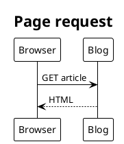

# PlantUML in Markdown

> Type: Reference  
> Status: Active  
> Scope: Markdown fences, local SVG generation and offline static builds

Use one complete diagram in a fenced block with language `plantuml`. Text after
the language becomes image alt text; supply a short description for accessibility.

````markdown

````

Install locked dependencies with `pnpm install --frozen-lockfile`. To add or edit
diagrams, install Java 21 or newer and run `pnpm diagrams:render` from the repository
root. If Java is not on PATH, set `PLANTUML_JAVA` to its executable's absolute path
(PowerShell: `$env:PLANTUML_JAVA = 'C:\path\to\java.exe'`). The pinned
`plantuml-cli` dependency supplies the authentic PlantUML 1.2026.8 JAR; no public
diagram service receives source. Graphviz is needed for diagram types that use
its layout engine; sequence diagrams and `!pragma layout smetana` diagrams avoid
that prerequisite. A missing renderer or syntax error fails with the source file
and fence location. Rendering times out after 30 seconds per diagram.

The command scans Markdown/MDX files under `src/content`, including drafts. Commit
the Markdown and generated `public/diagrams/plantuml/<sha256>.svg` together. The hash
includes the normalized source and renderer version; source changes require a new
SVG. Use the same renderer, Java, fonts and layout engine for reproducible SVG
bytes across machines. Line endings are normalized, source metadata is omitted,
and no timestamp is added by the tooling. SVG files are renderer output; do not
edit them manually. Old unreferenced SVGs may be removed after checking references.

`pnpm build` and `pnpm dev` only read and embed these local SVGs as images, before
code highlighting. They require neither Java nor external rendering services,
including on Cloudflare's static build environment. A missing, stale or invalid
SVG stops the build and instructs the author to regenerate it. Ordinary code
fences retain their existing syntax highlighting and copying behavior.

The build first validates every Markdown/MDX file under `src/content`, including
drafts, using the same fence and cached-SVG checks as the Markdown plugin. This
explicit preflight makes failures exit nonzero even when Astro's content loader
would otherwise log and skip an invalid entry. It reads caches without Java.

Keep each fence self-contained with exactly one `@startuml` / `@enduml` pair.
External includes/imports and file/environment reads are unsupported, and local
rendering uses PlantUML's sandbox security profile. Use built-in themes and stable
aliases. The draft [example article](../../src/content/posts/plantuml-example.md)
demonstrates a static-page request; set `draft: false` when ready to publish it.
