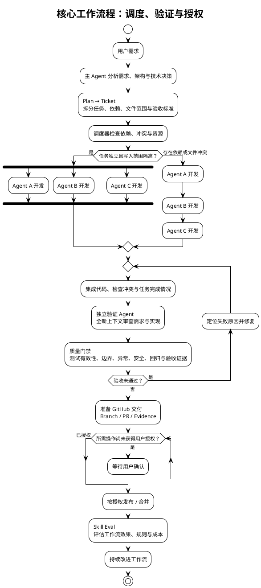
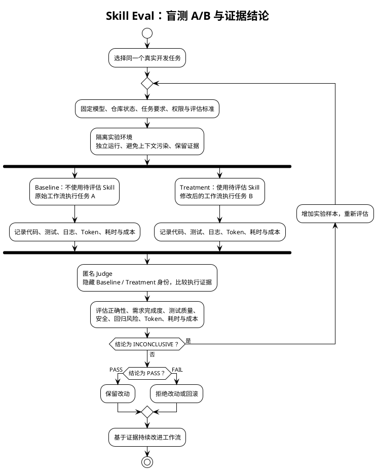
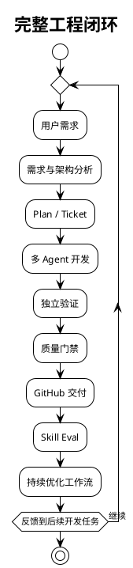

自己在使用codex过程中，由于前期模型能力有限，做出的产品常常不符合预期。于是自己编写了一套workflow，将需求分析，开发，测试，验证与模型编排调度集成到一起。本项目经过100+pr的迭代更新，可以稳定的实现各种需求，保证想法和做出的产品效果一致。

## Codex Development Workflow

一套面向 **Codex 与 Claude Code 的多 Agent 智能软件开发工作流（Agent Harness）**。

GitHub：[i-zrhe2016/codex-development-workflow](https://github.com/i-zrhe2016/codex-development-workflow)

**项目核心理念：让 AI 不只是编写代码，而是像成熟的软件工程团队一样，有计划、有分工、有验证地完成开发。**

## 一、与普通 AI 编程工作流有什么不同？

### 1. 自适应多 Agent 协作

主 Agent 负责需求分析、架构设计、任务拆分和调度，子 Agent 负责具体实现与验证。

根据任务依赖、文件冲突和系统资源，动态决定并行、串行或分批执行，而不是简单地同时启动多个 Agent。

### 2. 独立验证机制

开发 Agent 不负责最终验收。

由全新上下文的验证 Agent 独立检查代码、测试结果与需求完成情况，减少 AI 自己编写代码、自己证明正确的问题。

### 3. 风险驱动的质量门禁

不仅要求测试通过，还要检查测试本身是否有效。

包括边界条件、异常路径、权限安全、回归风险，以及测试是否真正覆盖需求。

### 4. GitHub 原生任务管理

采用 **Plan → Ticket → Branch → PR** 的任务管理结构。

将需求、实现、验收证据与交付过程关联起来，支持任务中断后的状态恢复与继续执行。

### 5. 智能上下文管理

主 Agent 保持精简上下文，子 Agent 根据任务按需加载必要信息。

任务结束后保留关键决策与验证证据，减少无关上下文和重复 Token 消耗。

### 6. Skill Eval 自我改进

开发完成后，不仅评估代码，还评估工作流本身。

通过真实任务的盲测 A/B 对比，验证 Skill 修改是否有效，避免凭主观感觉不断增加规则。

### 7. 分阶段交付与权限控制

规划、开发、验证、发布和合并分别管理。

AI 可以完成授权范围内的开发与验证，但 Commit、Push、PR、Merge 等操作必须遵循用户授权边界。

## 二、核心工作流程

整个工作流分为六个阶段：

**需求分析 → 任务规划 → Agent 调度 → 独立验证 → GitHub 交付 → 持续改进**

**核心设计原则：**

多 Agent 并行不是目标，而是一种调度策略。真正的目标是在保证任务隔离、代码质量和结果可追溯的前提下，提高复杂软件开发的可靠性与效率。

当任务存在依赖或文件冲突时，工作流优先保证正确性，而不是强行并行。

当验证失败时，重新进入修复与验证流程，而不是直接交付。

## 三、核心方法：Skill Eval 盲测 A/B 对比

传统的 Skill 优化通常依赖主观判断：

修改提示词、增加规则，然后观察模型是否表现得更好。

但这种方式存在一个问题：**无法区分 Skill 本身带来的改善与模型输出的随机波动。**

因此，工作流引入 Skill Eval，通过控制实验条件和匿名评审，对 Skill 改动进行可衡量的评估。

### Skill Eval 工作流程

### 评估结果的含义

| 结果 | 含义 | 后续动作 |
|---|---|---|
| PASS | 有足够证据支持 Skill 改动达到预设改进标准 | 保留改动 |
| FAIL | 改动未达到预设标准，或出现不可接受的退化 | 拒绝或回滚 |
| INCONCLUSIVE | 证据不足，无法可靠判断优劣 | 增加样本或重新实验 |

一次实验不能证明 Skill 在所有任务上都更好。因此，评估需要结合任务代表性、重复实验、成本与质量指标综合判断。

**Skill 的改进不以规则数量衡量，而以真实任务中的可重复实验结果衡量。**

## 四、完整工程闭环

Codex Development Workflow 不只是一个多 Agent 调度系统，而是把软件工程的多个环节连接起来。

这一闭环包含两个层次：

**第一层：产品开发闭环**

通过需求分析、任务规划、Agent 协作、独立验证和质量门禁，确保开发结果尽可能符合预期。

**第二层：工作流改进闭环**

通过 Skill Eval 对工作流改动进行实验评估，持续改进 Agent 的执行方式，而不是依赖经验不断堆积提示词。

## 五、最大的差异化优势

普通 AI Coding 工具主要关注：

**如何更快地生成代码。**

Codex Development Workflow 更关注：

**如何通过多 Agent 协作、独立质量验证、持久化任务状态和可衡量的流程改进，让 AI 开发复杂软件变得可靠、可控、可恢复。**

其核心价值体现在：

1. **可靠性**：开发与验证分离，减少未经独立检查的结果直接进入交付。
2. **可控性**：根据任务依赖和风险动态调度，关键操作遵循授权边界。
3. **可恢复性**：任务状态与 GitHub 工作流关联，支持中断后继续。
4. **可追溯性**：需求、代码、测试、验收证据与交付结果形成关联。
5. **可改进性**：通过 Skill Eval 的实验结果驱动工作流迭代。

它的独特价值不是某一项孤立技术，而是把这些机制整合为一套完整的软件工程工作流。

---

项目地址：[Codex Development Workflow](https://github.com/i-zrhe2016/codex-development-workflow)

*说明：以上主要介绍项目的设计理念与工作流机制，不代表已经通过严格的量化实验验证所有效率和质量提升。*
