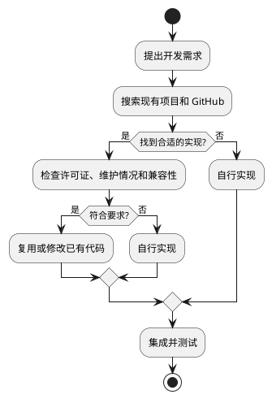
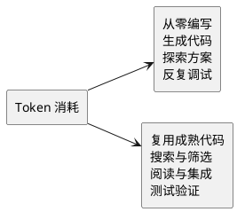

使用 Claude Code、Codex 编程时，很多人习惯让 AI 从零实现功能。

但 GitHub 上可能早已有成熟的开源代码。直接复用，不仅能减少代码生成，还可能节省调试消耗的 Token。

## GitPilfer：先搜索，再写代码

[GitPilfer](https://github.com/pilgrimdelamare/GitPilfer) 是一个面向 AI 编程工具的 Skill。

核心原则：先搜索 GitHub，找到合适的实现就复用，找不到再自己写。

## 为什么能节省 Token？

从零编写需要生成代码、探索实现方案，还可能反复调试。

复用成熟代码则把工作转向搜索、筛选和集成。

成熟代码通常处理过部分常见问题和边界情况，因此有机会减少重新实现和调试的成本。

但搜索和理解代码同样消耗 Token，复用并不保证每次都更省。

## 什么时候应该复用？

不是所有 GitHub 代码都值得采用。

需要考虑许可证、维护情况、安全性、兼容性和测试结果。如果功能非常简单，从零编写反而可能更划算。

推荐采用以下优先级：

## 总结

GitPilfer 的价值在于改变 AI 的编程习惯：先找成熟实现，再决定要不要写新代码。

实际节省多少 Token，还需要根据任务测试验证。

AI 编程不只是让代码生成得更快，也要尽量减少不必要的重复开发。
