Kubernetes（K8s）的存储机制，本质上是将底层存储资源抽象成可以被 Pod 声明、分配、挂载、使用和回收的资源管理体系。

理解 K8s 存储，最重要的不是记住所有存储类型，而是理解以下关系：

容器需要存储 → Pod 定义 Volume → PVC 声明存储需求 → PV 表示存储资源 → StorageClass 定义供给策略 → CSI 驱动操作底层存储。

下面按概念的依赖关系展开，先讲原子概念，再组合成完整工作流程。

## 一、K8s 存储架构总览

存储资源依赖关系

StorageClass 不位于上述实际数据读写路径中。它在动态供给阶段指定 Provisioner、创建参数和绑定策略，帮助 PVC 获得 PV。

从职责上看，可以分成三层：

| 层次              | 核心对象                         | 职责                     |
| ----------------- | -------------------------------- | ------------------------ |
| 应用使用层        | Pod、Volume、PVC                 | 申请和使用存储           |
| Kubernetes 管理层 | PV、StorageClass、控制器、调度器 | 管理资源、绑定与调度     |
| 存储实现层        | CSI、Storage Backend             | 创建、附加、挂载底层存储 |

这里有两个非常重要的区别：

- 控制路径（Control Path）：决定存储应该如何创建、绑定和挂载。
- 数据路径（Data Path）：容器实际读取和写入文件所经过的路径。

K8s 主要负责控制路径；容器的正常数据 I/O 一般不会经过 API Server 或 etcd。

## 二、容器文件系统：为什么需要 Volume？

### 2.1 Container Writable Layer（容器可写层）

容器镜像由多个只读镜像层（Image Layers）组成，容器启动后，容器运行时通常会在其上增加一个可写层（Writable Layer）。

这种机制常通过 OverlayFS 等联合文件系统实现。

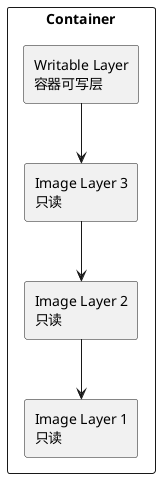

关键问题： 容器可写层与容器实例的生命周期绑定。

当容器被替换或重新创建时，原来的可写层可能被删除，数据不应被视为持久化数据。

注意：容器内进程重启，不等于容器被重新创建。

### 2.2 Volume（存储卷）

Volume 是 Kubernetes 定义的存储抽象，用来向 Pod 中的容器提供文件目录或块设备。

它与 Container Writable Layer 最核心的区别是：

Volume 的生命周期不一定等于容器生命周期。

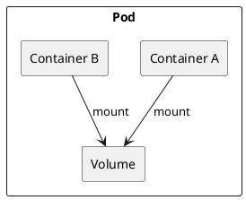

一个 Pod 可以定义多个 Volume。

一个 Volume 也可以被同一个 Pod 内的多个容器挂载，具体读写权限取决于挂载配置和存储能力。

因此：

- `spec.volumes`：定义 Pod 使用什么卷。
- `volumeMounts`：定义容器把卷挂载到哪个文件系统路径。
- `mountPath`：容器内的挂载目标路径。

Volume 本身不是一种物理磁盘，而是对不同存储来源的统一接口。

### 2.3 Volume 生命周期

不同 Volume 类型具有不同的生命周期规则。

| Volume 类型             | 与 Pod 生命周期的关系     | 典型用途           |
| ----------------------- | ------------------------- | ------------------ |
| `emptyDir`              | Pod 删除后数据通常消失    | 缓存、临时文件     |
| `configMap`             | 数据来源于 ConfigMap      | 应用配置           |
| `secret`                | 数据来源于 Secret         | 密钥、凭证         |
| `persistentVolumeClaim` | 底层 PV 可独立于 Pod 存在 | 数据库、持久化文件 |

这里引出两个概念：

Ephemeral Storage（临时存储） 和 Persistent Storage（持久化存储）。

## 三、临时存储机制

### 3.1 emptyDir

`emptyDir` 是最常见的临时 Volume。

Pod 被分配到节点后，Kubelet 为其准备一个初始为空的目录。

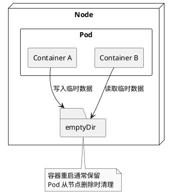

它具有三个主要特征：

- 由同一 Pod 内的容器共享。
- 容器崩溃并重新启动后通常仍然存在。
- Pod 被删除或从节点移除后，数据会被清理。

`emptyDir.medium: Memory` 可以使用 tmpfs，将数据放在内存中；此时使用量主要受内存资源约束，而不是磁盘临时存储配额。

### 3.2 Node Local Ephemeral Storage

节点本地临时存储还包括：

- 容器可写层（Writable Layer）
- 容器日志（Container Logs）
- 磁盘形式的 `emptyDir`

Kubelet 负责跟踪部分临时存储使用情况，并通过 Eviction（驱逐） 机制在节点磁盘资源紧张时处理 Pod。

相关概念关系：

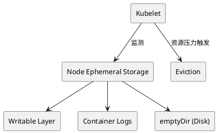

`ephemeral-storage` 可以用于 Pod 的资源请求和限制，但并不意味着 Kubernetes 会为每个 Pod 分配独立的物理磁盘分区。

## 四、持久化存储：PV 与 PVC

这是 Kubernetes 存储体系的核心。

### 4.1 PV（PersistentVolume）

PV 是集群级别（Cluster-scoped）的持久卷资源。

它表示 Kubernetes 可以管理和分配的一份存储资源，例如：

- 一块云平台块存储卷
- 一个 NFS 共享目录
- 一个 Ceph RBD 卷
- 一块本地磁盘

PV 描述存储资源的容量、访问模式、存储类别、回收策略以及实际存储来源等信息。

PV 是 Kubernetes 对存储资源的声明和管理对象，不等于物理磁盘本身。

### 4.2 PVC（PersistentVolumeClaim）

PVC 是 Namespace 级别（Namespaced）的持久卷声明。

它描述使用者需要什么样的存储。

例如：

```yaml
apiVersion: v1
kind: PersistentVolumeClaim
metadata:
  name: mysql-data
spec:
  accessModes:
    - ReadWriteOnce
  resources:
    requests:
      storage: 10Gi
```

这表示申请至少 `10Gi` 的存储容量，并要求对应的访问模式为 `ReadWriteOnce`。

PVC 不需要直接知道底层到底使用 NFS、Ceph 还是云磁盘。

这种机制叫作 存储资源与存储使用者解耦（Decoupling）。

### 4.3 PV 与 PVC 的绑定

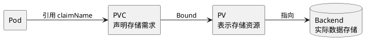

关系可以理解为：

- Pod 是存储的使用者。
- PVC 是存储的申请单。
- PV 是已分配的存储资源。
- Backend 是实际保存数据的存储系统。

PVC 与 PV 通常是一对一绑定。

多个 Pod 可以使用同一个 PVC，但必须满足底层存储、访问模式以及挂载约束。

### 4.4 PV 与 PVC 的状态

PVC 常见状态：

| 状态      | 含义                           |
| --------- | ------------------------------ |
| `Pending` | 等待匹配或创建 PV              |
| `Bound`   | 已绑定 PV                      |
| `Lost`    | 已绑定的 PV 不再可用或无法找到 |

PV 常见状态：

| 状态        | 含义                       |
| ----------- | -------------------------- |
| `Available` | 可以进行绑定               |
| `Bound`     | 已绑定 PVC                 |
| `Released`  | PVC 被删除，但尚未完成回收 |
| `Failed`    | 自动回收操作失败           |

注意：`Bound` 表示 PV/PVC 的资源绑定已经完成，不代表 Pod 已经成功挂载卷，更不保证应用能够正常读写。

## 五、StorageClass：存储资源如何自动创建？

前面介绍的 PV/PVC 解决了存储资源与使用者之间的绑定问题，但还没有解释：

如果 PVC 申请存储时，集群里没有合适的 PV，该怎么办？

这就需要 StorageClass。

### 5.1 StorageClass（存储类）

StorageClass 是集群级别的存储供给策略对象。

它通常指定：

| 字段                   | 概念                    | 作用                       |
| ---------------------- | ----------------------- | -------------------------- |
| `provisioner`          | Provisioner（供应器）   | 指定由谁创建存储           |
| `parameters`           | Provisioning Parameters | 传递给供应器的创建参数     |
| `reclaimPolicy`        | Reclaim Policy          | 指定动态创建的 PV 如何回收 |
| `volumeBindingMode`    | Volume Binding Mode     | 控制存储创建或绑定的时机   |
| `allowVolumeExpansion` | Volume Expansion        | 是否允许扩容               |

例如：

```yaml
apiVersion: storage.k8s.io/v1
kind: StorageClass
metadata:
  name: fast-ssd
provisioner: disk.csi.example.com
reclaimPolicy: Retain
allowVolumeExpansion: true
volumeBindingMode: WaitForFirstConsumer
```

这里的 `disk.csi.example.com` 是示例驱动名称，真实集群必须替换为已经安装的 CSI 驱动标识。

StorageClass 并不是一个存储卷，它描述的是如何提供存储卷。

### 5.2 Dynamic Provisioning（动态供给）

动态供给是指在 PVC 提交存储请求后，由供应器按需创建底层存储和对应的 PV。

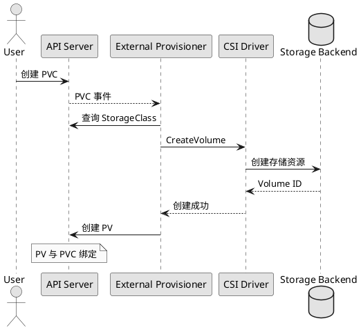

图中省略了 WaitForFirstConsumer 模式涉及的调度等待。

动态供给的完整逻辑：

1. 用户创建 PVC。
2. PVC 通过 `storageClassName` 选择 StorageClass。
3. Provisioner 根据 StorageClass 获得 CSI 驱动和存储创建参数。
4. CSI 驱动调用后端存储 API 创建实际卷。
5. Provisioner 创建 Kubernetes PV 对象。
6. PV 与 PVC 完成绑定。

这意味着创建一个 PVC，就可以间接触发实际磁盘的创建。

Kubernetes 称这种机制为 Dynamic Volume Provisioning。

### 5.3 Static Provisioning（静态供给）

静态供给是指管理员事先创建底层存储与 PV，然后让 PVC 与它匹配。

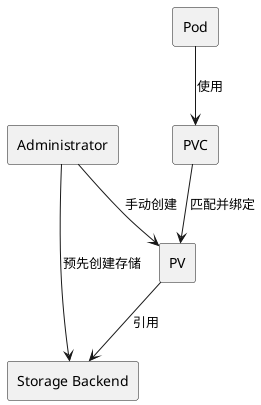

对比两种模式：

| 维度         | Static Provisioning    | Dynamic Provisioning |
| ------------ | ---------------------- | -------------------- |
| 存储创建者   | 管理员                 | Provisioner          |
| PV 创建时间  | PVC 申请之前           | 按需创建             |
| StorageClass | 可选                   | 通常需要             |
| 自动化程度   | 较低                   | 较高                 |
| 典型用途     | 已有 NFS、指定本地磁盘 | 云磁盘、CSI 存储平台 |

## 六、CSI：Kubernetes 如何控制底层存储？

### 6.1 CSI（Container Storage Interface）

CSI 是容器编排系统与存储系统之间的一套标准接口规范。

它使 Kubernetes 不必直接实现每一种存储产品的内部逻辑。

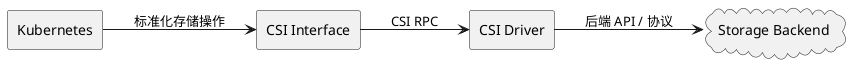

CSI 通常使用 gRPC 描述操作接口。

这里需要区分三个概念：

- CSI Specification：存储接口规范。
- CSI Driver：实现规范的存储驱动。
- Storage Backend：真正保存数据的系统。

例如，Ceph RBD CSI Driver 负责将 CSI 请求转换成 Ceph 能理解的存储操作。

### 6.2 CSI Driver 的三个服务

CSI 协议将驱动能力划分为三类主要服务：

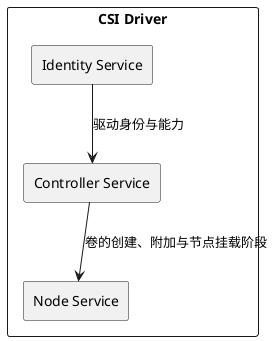

#### Identity Service（身份服务）

用于查询驱动身份和能力，例如 `GetPluginInfo`。

解决的问题是：这是哪个 CSI 驱动？

#### Controller Service（控制器服务）

主要负责存储系统侧的操作。

重要接口：

| CSI RPC                     | 作用               |
| --------------------------- | ------------------ |
| `CreateVolume`              | 创建存储卷         |
| `DeleteVolume`              | 删除存储卷         |
| `ControllerPublishVolume`   | 将卷附加到指定节点 |
| `ControllerUnpublishVolume` | 从节点解除附加     |
| `ControllerExpandVolume`    | 执行控制器侧扩容   |

这些能力属于可选能力集合，并非所有 CSI 驱动都支持每个接口。

#### Node Service（节点服务）

运行在节点侧，负责将存储准备好供容器使用。

重要接口：

| CSI RPC               | 作用                         |
| --------------------- | ---------------------------- |
| `NodeStageVolume`     | 将卷准备到节点的全局暂存路径 |
| `NodePublishVolume`   | 将卷发布到 Pod 的目标路径    |
| `NodeUnpublishVolume` | 撤销 Pod 对卷的使用          |
| `NodeUnstageVolume`   | 清理节点级暂存状态           |

`NodeStageVolume` 也是可选接口。驱动支持它时，通常可以把节点级准备与 Pod 级挂载分开。

### 6.3 CSI Sidecar（边车组件）

CSI Driver 只负责实现标准接口，而 Kubernetes 的资源监听、协调与状态管理，通常由 CSI Sidecar 协助完成。

常见组件如下：

| 组件                    | 关联资源/动作                              |
| ----------------------- | ------------------------------------------ |
| `external-provisioner`  | PVC → CreateVolume                         |
| `external-attacher`     | VolumeAttachment → ControllerPublishVolume |
| `external-resizer`      | PVC 扩容 → ControllerExpandVolume          |
| `external-snapshotter`  | 卷快照 → CreateSnapshot                    |
| `node-driver-registrar` | 向 Kubelet 注册 CSI 驱动                   |

这里最容易混淆的是：

Provisioner 不是 CSI Driver 本身。

Provisioner 负责监听 Kubernetes 对象，并调用 CSI Driver；CSI Driver 再负责与底层存储交互。

### 6.4 CSI 组件部署架构

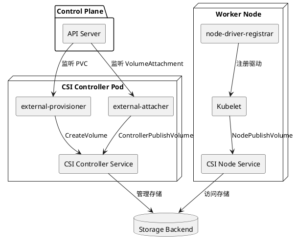

典型部署方式：

- CSI Controller 组件运行在 Deployment 中。
- CSI Node 组件通过 DaemonSet 分布在 Worker Node 上。
- Kubelet 通过本地 Unix Domain Socket 与 CSI Node Service 通信。
- Controller 和 Node 服务由同一套 CSI 驱动实现，但可以部署在不同 Pod 中。

这些属于常见实现架构，并非 CSI 规范强制要求的唯一部署形式。

## 七、存储调度：为什么 Pod 必须考虑存储的位置？

存储并不一定在所有节点上都可以使用。

例如云盘可能仅存在于特定可用区（Availability Zone），本地磁盘则仅存在于指定 Node。

因此 Pod Scheduling 与 Volume Binding 必须协同完成。

### 7.1 Volume Binding Mode

StorageClass 有两个主要绑定模式。

#### Immediate（立即绑定）

PVC 创建后，就可以立即匹配已有 PV 或启动动态供给。

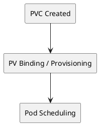

风险在于存储可能被创建在不适合 Pod 的拓扑位置。

#### WaitForFirstConsumer（延迟绑定）

将 PV 选择或动态供给推迟到出现使用该 PVC 的 Pod 后，再结合 Pod 调度条件进行决策。

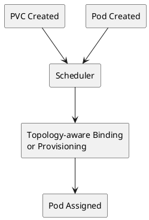

Scheduler 可以综合考虑：

- Node Affinity（节点亲和性）
- Pod Affinity / Anti-Affinity（Pod 亲和与反亲和）
- Taints / Tolerations（污点与容忍）
- Storage Topology（存储拓扑）
- Node Resources（节点资源）

`WaitForFirstConsumer` 特别适合具有可用区或节点位置限制的存储。

### 7.2 Topology Awareness（拓扑感知）

例如一个集群横跨两个可用区：

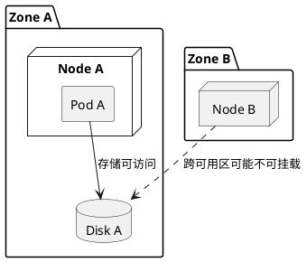

如果卷只能在 Zone A 挂载，调度器就必须考虑将使用它的 Pod 放置到兼容的节点上。

相应地，PV 可以使用 `nodeAffinity` 描述位置约束，CSI 动态供给也可以通过拓扑信息选择卷创建位置。

注意：本地卷的 Node Affinity 与 Pod 的 Node Affinity 不是同一个对象上的字段，但两者都可能影响最终的调度结果。

## 八、存储挂载：Attach、Mount 与 Bind Mount

PV/PVC 绑定成功，并不意味着容器已经拿到存储设备。

还需要完成节点侧的准备。

### 8.1 Attach（附加）

Attach 是将存储卷关联到某个 Node，使该节点能够访问卷。

对于云块存储，可能体现为把云磁盘附加到虚拟机。

CSI 体系中通常由 `ControllerPublishVolume` 实现。

不是所有存储都需要 Attach。例如一些网络文件系统可以由节点直接挂载。

### 8.2 Mount（挂载）

Mount 是把文件系统接入到某个目录，使操作系统能够通过目录路径访问数据。

例如：

```
mount /dev/sdb /data
```

这里 `/dev/sdb` 是设备，`/data` 是挂载点。

在 Kubernetes 中，Kubelet 与 CSI Node 插件协同完成挂载。

### 8.3 Volume Mount（容器卷挂载）

卷可以被挂载到容器内部目录，例如：

```
volumeMounts:
  - name: data
    mountPath: /var/lib/mysql
```

`mountPath` 是容器内部能看到的目录，不是底层云盘的名称。

### 8.4 完整挂载流程

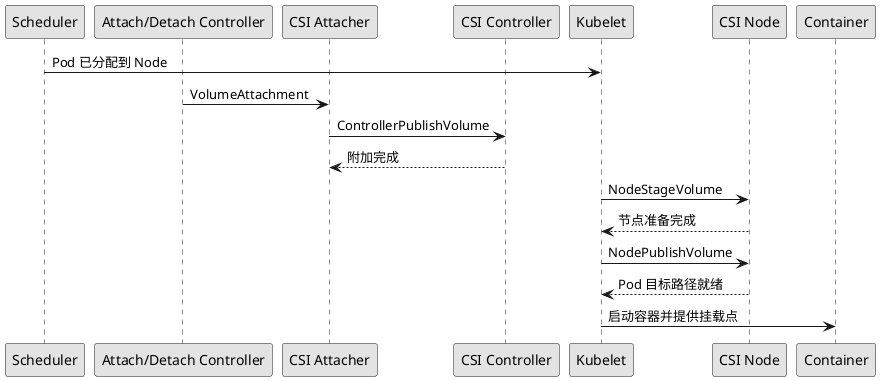

上图展示了需要 Controller Attach 与 Node Stage 的典型 CSI 块存储路径，不适用于所有驱动。

必须区分：

`PVC Bound` → `Volume Attached` → `Volume Staged/Published` → `Container Started`

它们是不同阶段。

这也解释了为什么会出现 PVC 已经 Bound，但 Pod 仍处于 `ContainerCreating` 的情况。

## 九、Access Mode：存储允许谁访问？

Access Mode（访问模式）描述 PV 的访问能力，也是 PV/PVC 匹配时使用的条件。

Kubernetes 定义四种主要访问模式：

| 模式             | 缩写 | 含义            |
| ---------------- | ---- | --------------- |
| ReadWriteOnce    | RWO  | 单节点读写      |
| ReadOnlyMany     | ROX  | 多节点只读      |
| ReadWriteMany    | RWX  | 多节点读写      |
| ReadWriteOncePod | RWOP | 单 Pod 独占读写 |

其中，RWO 限制的是节点，不是 Pod 数量。

### 9.1 ReadWriteOnce

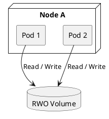

同一个节点上的两个 Pod，在存储驱动和挂载条件允许时，可以共同使用 RWO 卷。

但是 RWO 通常不允许跨多个节点同时读写挂载。

### 9.2 ReadWriteMany

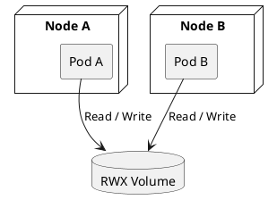

RWX 适合需要跨节点共享文件的应用，例如共享文件目录。

但要注意：RWX 不等于自动解决数据一致性问题。 应用仍可能需要文件锁、数据库事务或其他并发控制机制。

### 9.3 ReadWriteOncePod

RWOP 将独占范围从 Node 缩小到 Pod。

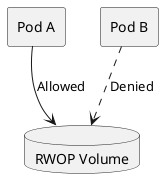

RWOP 适合要求一个 PVC 在整个集群中只能被单个 Pod 使用的场景，它依赖支持该模式的 CSI 驱动。

访问模式并不是通用的文件系统权限管理机制，实际只读保护仍应结合挂载选项和存储后端能力理解。

## 十、VolumeMode：文件系统与块设备

`volumeMode` 决定存储卷以哪种形态交给应用使用。

### 10.1 Filesystem

`volumeMode: Filesystem` 是默认模式。

应用通过目录访问数据，文件系统负责将文件操作转换成块设备 I/O。

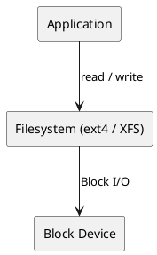

典型用途是 MySQL 数据目录、日志和普通文件存储。

### 10.2 Block

`volumeMode: Block` 将原始块设备提供给容器。

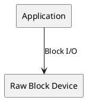

应用需要自己理解如何操作块设备。

注意：`Block` 并不必然比 `Filesystem` 更快，其性能取决于应用、文件系统、存储后端及 I/O 模式。

## 十一、Reclaim Policy：PVC 删除后数据去哪了？

Reclaim Policy（回收策略）属于 PV 生命周期管理。

它控制 PVC 释放 PV 后，Kubernetes 如何处理这份存储资源。

### 11.1 Retain（保留）

删除 PVC 后，PV 和底层数据不会被自动清理。

管理员需要手动检查并决定是否重新使用或删除存储。

### 11.2 Delete（删除）

PVC 被删除并释放 PV 后，控制器将按照策略删除 PV 和对应的底层存储资源。

这里涉及异步回收与保护机制，并不是 PVC 删除操作发生的同一瞬间就一定完成物理删除。

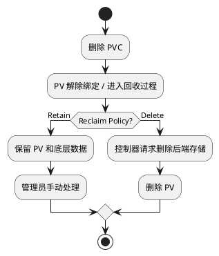

对比：

| 策略     | PVC 删除后的底层数据 | 适合场景                   |
| -------- | -------------------- | -------------------------- |
| `Retain` | 保留，需手动管理     | 重要数据库、人工回收       |
| `Delete` | 自动删除             | 自动化开发环境、可重建数据 |

动态供给使用的 StorageClass 如果没有显式指定 `reclaimPolicy`，默认通常是 `Delete`。手动创建 PV 时，默认是 `Retain`。

生产环境中，创建数据库 PVC 前，应明确检查实际 PV 的回收策略。

## 十二、StatefulSet 与持久化存储

前面讨论的是单个 Pod 如何使用 PVC。

但数据库等 Stateful Application（有状态应用）通常还需要稳定的存储身份。

### 12.1 StatefulSet

StatefulSet 为 Pod 提供稳定的身份，包括：

- Stable Pod Identity：稳定的 Pod 名称和序号。
- Stable Network Identity：配合 Headless Service 使用稳定的网络身份。
- Stable Storage：通过 PVC 为实例保留持久化存储。

### 12.2 volumeClaimTemplates

StatefulSet 可以通过 `volumeClaimTemplates` 为各 Pod 分别生成 PVC。

```plantuml
@startuml
skinparam monochrome true
skinparam shadowing false

rectangle "StatefulSet: mysql" as S

rectangle "mysql-0" as P0
rectangle "mysql-1" as P1
rectangle "mysql-2" as P2

rectangle "PVC-0" as C0
rectangle "PVC-1" as C1
rectangle "PVC-2" as C2

database "PV-0" as V0
database "PV-1" as V1
database "PV-2" as V2

S --> P0
S --> P1
S --> P2

P0 --> C0
P1 --> C1
P2 --> C2

C0 --> V0
C1 --> V1
C2 --> V2
@enduml
```

其核心关系是：

一个 StatefulSet 管理多个稳定身份的 Pod，每个 Pod 可以有自己独立的 PVC。

当 Pod 被删除并重建时，通常能够使用原有 PVC 重新访问数据。

但这不代表 StatefulSet 自身提供数据复制或容灾能力。数据库复制、主从选举和数据一致性仍由数据库软件或 Operator 负责。

StatefulSet 缩容或删除时 PVC 的处理还与 `persistentVolumeClaimRetentionPolicy` 有关，不能简单假设所有 PVC 一定保留。

## 十三、VolumeSnapshot：如何创建存储快照？

VolumeSnapshot（卷快照）代表对某个存储卷在特定时间点的数据状态进行记录。

它类似于 PVC/PV 体系，但管理的是快照资源。

### 13.1 三个核心对象

| 对象                  | 对应概念          | 职责             |
| --------------------- | ----------------- | ---------------- |
| VolumeSnapshot        | 类似 PVC          | 提出快照需求     |
| VolumeSnapshotContent | 类似 PV           | 表示实际快照资源 |
| VolumeSnapshotClass   | 类似 StorageClass | 定义快照创建策略 |

### 13.2 快照创建关系

```plantuml
@startuml
skinparam monochrome true

rectangle "PVC" as PVC
rectangle "VolumeSnapshot" as VS
rectangle "VolumeSnapshotClass" as SC
rectangle "VolumeSnapshotContent" as VC
rectangle "CSI Snapshotter" as CSI
database "Backend Snapshot" as BS

VS --> PVC : source
VS --> SC : class
VS --> VC : 绑定
VC --> CSI : 快照操作
CSI --> BS : CreateSnapshot
@enduml
```

VolumeSnapshot 依赖 CSI 驱动及其快照支持，还需要安装对应的快照 CRD 和控制器。

快照可以成为新 PVC 的数据源，实现从快照恢复数据。

不过，存储快照并不自动保证数据库事务一致性。实际备份时仍需要考虑应用冻结、日志刷新以及异地备份。

## 十四、完整示例：从 PVC 到容器写入数据

下面把 StorageClass、PVC、Pod 连接起来。

示例假设集群已经安装了支持动态供给的 CSI 驱动。

### 14.1 创建 StorageClass

```yaml
apiVersion: storage.k8s.io/v1
kind: StorageClass
metadata:
  name: demo-storage
provisioner: disk.csi.example.com
reclaimPolicy: Retain
volumeBindingMode: WaitForFirstConsumer
allowVolumeExpansion: true
```

需要把 `provisioner` 替换成集群实际安装的驱动名称。

### 14.2 创建 PVC

```yaml
apiVersion: v1
kind: PersistentVolumeClaim
metadata:
  name: demo-pvc
spec:
  storageClassName: demo-storage
  accessModes:
    - ReadWriteOnce
  resources:
    requests:
      storage: 10Gi
```

### 14.3 创建 Pod

```yaml
apiVersion: v1
kind: Pod
metadata:
  name: demo-pod
spec:
  containers:
    - name: app
      image: busybox:1.36
      command:
        - sh
        - -c
        - "echo hello > /data/test.txt; sleep 3600"
      volumeMounts:
        - name: data-volume
          mountPath: /data

  volumes:
    - name: data-volume
      persistentVolumeClaim:
        claimName: demo-pvc
```

三个资源之间的字段关联：

```plantuml
@startuml
skinparam monochrome true
skinparam shadowing false
left to right direction

rectangle "Pod" as POD {
}
rectangle "PVC" as PVC
rectangle "StorageClass" as SC
rectangle "PV" as PV
database "Storage Backend" as B

POD --> PVC : claimName
PVC --> SC : storageClassName
PVC --> PV : Binding
SC ..> PV : 动态供给策略
PV --> B : Volume ID
@enduml
```

Pod 运行后，可以执行：

```
kubectl get sc
kubectl get pvc
kubectl get pv
kubectl get pods

kubectl describe pvc demo-pvc
kubectl describe pod demo-pod

kubectl exec demo-pod -- cat /data/test.txt
```

如果一切正常，最后一条命令输出：

```
hello
```

Pod 被删除后，只要 PVC、PV 和底层存储仍然保留，使用相同 PVC 的新 Pod 就可以再次访问该文件。

## 十五、存储故障排查：从症状定位到组件

存储排查应根据资源所处阶段进行，而不是看到 Pod 启动失败就直接检查磁盘。

故障诊断路径

```plantuml
@startuml
skinparam monochrome true

start
:Pod 无法正常使用存储;

if (PVC Bound?) then (No)
  :检查 PVC Events;
  :检查 StorageClass;
  :检查 Provisioner 与 CSI;
else (Yes)
  if (Pod Scheduled?) then (No)
    :检查 Scheduler Events;
    :检查 PV Node Affinity;
    :检查存储拓扑约束;
  else (Yes)
    if (Volume Mounted?) then (No)
      :检查 VolumeAttachment;
      :检查 Kubelet / CSI Node;
      :检查 Attach / Mount 错误;
    else (Yes)
      :检查文件权限、容量和 I/O;
    endif
  endif
endif

stop
@enduml
```

| 症状                      | 可能的故障环节            | 优先检查                              |
| ------------------------- | ------------------------- | ------------------------------------- |
| PVC `Pending`             | PV 绑定、动态供给         | StorageClass、Provisioner、PVC Events |
| Pod `Pending`             | 调度与拓扑                | Scheduler Events、Node Affinity       |
| Pod `ContainerCreating`   | Attach / Mount            | Kubelet、CSI Node、VolumeAttachment   |
| `Multi-Attach error`      | 卷被其他节点使用          | 节点绑定、旧 Attach 状态              |
| `permission denied`       | 文件权限                  | UID/GID、fsGroup、挂载选项            |
| `no space left on device` | 存储容量或 inode 耗尽     | `df -h`、`df -i`、底层卷容量          |
| PVC 扩容未完成            | Controller/Node Expansion | CSI Resizer、PVC Conditions           |

最常用的排查命令：

```
kubectl get pvc -A
kubectl get pv
kubectl get storageclass
kubectl get volumeattachments

kubectl describe pvc <pvc-name>
kubectl describe pod <pod-name>

kubectl get events -A \
  --sort-by=.lastTimestamp
```

CSI 相关错误还需要查看对应 CSI Controller Pod 与 CSI Node Pod 的日志。

## 十六、K8s 存储的底层技术如何选择？

虽然 Kubernetes 提供统一的 Volume 抽象，但底层存储技术的能力差异很大。

| 存储类型     | 代表技术         | 关键特点                 | 常见用途           |
| ------------ | ---------------- | ------------------------ | ------------------ |
| 本地存储     | Local PV         | 数据与节点绑定           | 高性能本地工作负载 |
| 网络文件存储 | NFS、CephFS      | 文件共享，可支持 RWX     | 共享目录、文件服务 |
| 网络块存储   | Ceph RBD、云 EBS | 提供块设备               | 数据库、独立数据卷 |
| 分布式存储   | Ceph、Longhorn   | 多节点存储管理与副本机制 | 自建集群持久化     |

这里还有一个重要区分：

Kubernetes 负责存储的编排与生命周期管理，不等于 Kubernetes 自己实现了底层数据复制。

例如，使用 Ceph 时：

```plantuml
@startuml
skinparam monochrome true
skinparam shadowing false

rectangle "Pod" as P
rectangle "PVC" as C
rectangle "PV" as V
rectangle "Ceph CSI" as CSI

package "Ceph Cluster" {
  database "OSD 1" as O1
  database "OSD 2" as O2
  database "OSD 3" as O3
}

P --> C
C --> V
V --> CSI
CSI --> O1 : 存储操作
O1 <--> O2 : 副本 / 数据分布
O2 <--> O3 : 副本 / 数据分布
@enduml
```

图中副本关系是对 Ceph 后端行为的概念化表示，不代表 CSI 驱动在正常读写时负责复制每一次 I/O。Ceph 的 OSD 与集群内部机制才负责数据分布和冗余。

这解释了三个经常混淆的层次：

- Kubernetes：决定卷给谁使用、何时挂载以及何时回收。
- CSI：把 Kubernetes 存储操作转换为后端可执行的调用。
- 存储系统：负责数据读写、持久化、冗余以及具体的数据一致性实现。

## 十七、最终知识图谱

下面这张 PlantUML 图把全文核心概念连接起来，适合作为复习索引。

```plantuml
@startuml
skinparam monochrome true
skinparam shadowing false
top to bottom direction

package "Application Layer" {
  rectangle "Container" as C
  rectangle "Pod" as POD
  rectangle "Volume" as VOL
}

package "Storage API Layer" {
  rectangle "PVC" as PVC
  rectangle "PV" as PV
  rectangle "StorageClass" as SC
}

package "Control Layer" {
  rectangle "Scheduler" as S
  rectangle "Provisioner" as P
  rectangle "Attach / Detach" as A
  rectangle "Kubelet" as K
}

package "CSI Layer" {
  rectangle "CSI Controller" as CC
  rectangle "CSI Node" as CN
}

package "Storage Layer" {
  database "Storage Backend" as B
}

C --> POD : 属于
POD --> VOL : 定义
VOL --> PVC : 引用
PVC --> PV : Bound
PVC --> SC : 选择
SC --> P : 指定 Provisioner
P --> CC : CreateVolume
CC --> B : 创建存储

S --> POD : 调度
S --> PV : 考虑拓扑
A --> CC : Attach
K --> CN : Stage / Publish
CN --> B : 节点访问
PV --> B : 描述存储资源
@enduml
```

## 十八、必须掌握的概念关系

| 核心概念                 | 必须同时理解的关联概念            |
| ------------------------ | --------------------------------- |
| Container Writable Layer | 容器生命周期                      |
| Volume                   | Pod、volumeMounts                 |
| emptyDir                 | Pod 生命周期、临时存储            |
| PV                       | PVC、Backend、回收策略            |
| PVC                      | PV Binding、StorageClass          |
| StorageClass             | Provisioner、Dynamic Provisioning |
| CSI Driver               | Controller Service、Node Service  |
| CSI Sidecar              | Provisioner、Attacher、Resizer    |
| Scheduler                | Volume Binding、Topology          |
| Kubelet                  | Mount、CSI Node                   |
| AccessMode               | Node、Pod、驱动能力               |
| VolumeMode               | Filesystem、Block Device          |
| StatefulSet              | volumeClaimTemplates、PVC         |
| VolumeSnapshot           | SnapshotContent、SnapshotClass    |

建议按三个完整流程记忆，而不是孤立地背概念：

1. 创建路径：PVC → StorageClass → Provisioner → CSI Controller → Backend → PV → Bound。
2. 使用路径：Pod → Scheduler → Attach → Kubelet → CSI Node → Mount → Container I/O。
3. 回收路径：Pod 停止使用 → 卸载/解除附加 → PVC 释放 → PV Reclaim Policy → 保留或删除后端存储。

掌握这三条路径后，绝大多数 K8s 存储问题都能归类到资源供给、存储绑定、调度拓扑、卷挂载、数据访问、生命周期管理六个方面。

官方参考：[Kubernetes Storage](https://kubernetes.io/docs/concepts/storage/)、[Persistent Volumes](https://kubernetes.io/zh-cn/docs/concepts/storage/persistent-volumes/)、[StorageClass](https://kubernetes.io/docs/concepts/storage/storage-classes/)、[Volume Snapshots](https://kubernetes.io/docs/concepts/storage/volume-snapshots/)。