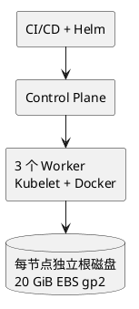
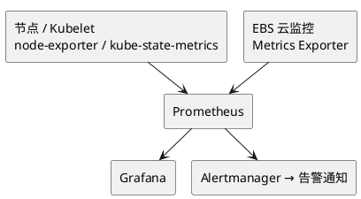

本文复盘一起 Kubernetes 集群在批量部署过程中发生的故障：最初 Pod 正常运行，随后出现 `Pending`、`Unknown` 和镜像拉取失败，最终多个 Worker 节点进入 `NotReady` 状态。

排查发现，节点磁盘 I/O 性能不足是重要的故障因素。替换异常节点、恢复服务后，运维人员又通过监控和复现实验进一步定位了存储瓶颈。

本文以匿名化案例的形式整理，不保留事故发生时间、原始公司名称及文章来源。技术环境仅保留与分析相关的必要信息。

## 一、故障背景

某团队使用 Kubernetes 承载开发、测试和持续集成任务。CI/CD 流水线负责构建应用、生成 Helm Chart、部署至 Kubernetes 集群，并运行自动化测试。

集群运行在云平台上，由一个控制平面和三个 Worker 节点组成。每个 Worker 节点使用独立的云块存储作为根磁盘。

| 项目 | 环境配置 |
| --- | --- |
| 集群类型 | Kubernetes 非生产集群 |
| Worker 节点 | 3 台 |
| 部署方式 | CI/CD + Helm |
| 容器运行时 | Docker（事故环境） |
| 节点磁盘 | 20 GiB gp2 云盘 |
| 应用规模 | 数十种容器，部署到多个环境 |
| 监控体系 | 云监控与第三方监控 |

### 1.1 集群部署架构



该架构的主要风险是：大量容器同时启动时，镜像拉取、解压和文件系统写入可能集中发生，使节点根磁盘成为性能瓶颈。

## 二、故障现象

故障发生在一次常规 CI/CD 部署期间。

部署初期，Pod 能够正常创建并进入 `Running` 状态。但随着部署继续，部分 Pod 开始出现异常，随后问题逐步扩展到 Worker 节点。

### 2.1 故障时间线

以下时间线只保留事件顺序，不展示具体日期或时刻。

1. 执行 CI/CD 部署，Pod 初始正常运行。
2. 部分 Pod 出现 `Pending`、镜像拉取失败和 `Unknown`。
3. 普通删除未能清理异常 Pod，进一步检查发现 Kubelet、Docker 异常。
4. 全部 Worker 节点进入 `NotReady`。
5. 替换异常节点，新节点加入后工作负载逐步恢复。

### 2.2 Pod 状态异常

执行：

```bash
kubectl get pods -A -o wide
```

可能观察到类似状态：

```text
NAME            READY   STATUS
service-a       1/1     Running
service-b       0/1     Pending
service-c       0/1     Unknown
service-d       0/1     ImagePullBackOff
```

以上为示意输出，并非原始事故日志。

这些状态反映了不同层面的问题：

- `Pending`：Pod 尚未完成调度或启动准备。
- `Unknown`：控制平面无法可靠获取 Pod 状态。
- `ImagePullBackOff`：容器镜像拉取失败，进入重试等待。
- `Running`：Pod 已绑定节点，且至少一个容器正在运行或处于启动、重启过程中，不代表业务一定健康。

### 2.3 节点状态异常

继续检查：

```bash
kubectl get nodes -o wide
```

```bash
kubectl describe node <node-name>
```

最终发现所有 Worker 节点均进入 `NotReady` 状态。

同时，节点上的 Kubelet 与容器运行时出现健康异常，远程登录也无法正常完成。

至此可以确认，故障已不再局限于单个应用，而是发生在节点层。

## 三、故障排查过程

### 3.1 最初怀疑镜像仓库异常

运维人员通过以下命令检查异常 Pod：

```bash
kubectl describe pod <pod-name> -n <namespace>
```

Events 中存在大量镜像拉取失败信息。

由于此前镜像仓库偶尔出现不稳定情况，加上集群使用的节点规格较低，运维人员最初怀疑是镜像拉取压力过大。

但镜像拉取失败只是观察到的现象，尚不能证明问题来自镜像仓库。

### 3.2 尝试删除异常 Pod

为恢复集群，运维人员首先尝试删除异常资源：

```bash
kubectl delete pod <pod-name> -n <namespace>
```

命令执行后，部分 Pod 没有按预期消失。

随后尝试强制删除：

```bash
kubectl delete pod <pod-name> \
  -n <namespace> \
  --force \
  --grace-period=0
```

Pod 从 Kubernetes API 中消失，但运维人员没有进一步检查节点上的容器是否真正终止。

这是本次故障处置中一个值得注意的问题。

强制删除 Pod 只意味着 API 对象被移除，不保证失联节点上的容器进程已经停止。对于 StatefulSet、有状态应用和共享存储场景，尤其需要注意双实例运行或数据一致性风险。

### 3.3 确认故障位于节点层

继续检查系统命名空间：

```bash
kubectl get pods -n kube-system -o wide
```

发现部分系统组件也处于异常状态。

随后检查节点：

```bash
kubectl describe nodes
```

发现容器运行时和 Kubelet 健康检查异常，Worker 节点均无法正常提供服务。

尝试 SSH 登录节点时，连接持续超时。

### 3.4 排查思路

- **Pod 层：** 检查 Events，确认调度、镜像仓库、认证和网络是否异常。
- **节点层：** 检查 `kube-system` 与 Node Conditions；多个应用同时异常时，检查 Kubelet、运行时和节点资源。
- **基础设施层：** 关联云主机状态与 EBS 指标，汇总证据并选择恢复方案。

从这个过程可以看出，当多个应用同时异常，并且系统组件也出现问题时，应及时将排查范围从 Pod 扩展到节点和底层基础设施。

## 四、故障恢复

确认多个 Worker 节点异常且无法远程登录后，运维人员决定替换异常云主机。

具体过程：

1. 终止异常 Worker 实例。
2. 由 Auto Scaling Group 创建新实例。
3. 等待新节点加入 Kubernetes 集群。
4. 验证节点状态及工作负载恢复情况。

新节点加入后，集群恢复正常。

### 4.1 恢复流程

- **替换前：** 能访问节点时先收集日志；无法访问时检查云平台实例状态，并确认副本与数据影响。
- **替换后：** 使用 `kubectl get nodes` 和 `kubectl get pods -A` 检查节点及工作负载；仍有异常则继续排查。

这种方式可以快速恢复非生产环境，但不适合作为所有生产故障的默认处理手段。

在生产环境中，应优先保留诊断证据，确认副本和存储状态，再决定是否执行节点隔离、驱逐或替换。

## 五、根因定位：EBS 磁盘 I/O 瓶颈

集群恢复后，运维人员没有立即结束事故处理，而是重新检查监控体系，并复现部署过程。

此前，云平台监控与第三方监控之间的集成不完整，导致节点异常时缺少足够的底层指标来判断问题。

修复监控后，运维人员重新执行部署，发现：

- EBS I/O 队列长度在部署过程中急剧上升。
- Worker 节点根磁盘容量仅为 20 GiB。
- 磁盘空间使用率约为 90%。
- gp2 磁盘性能与容量相关，较小容量限制了持续 I/O 能力。

这些证据支持磁盘 I/O 是重要瓶颈的判断。

### 5.1 故障传播链

批量部署 → 集中拉取、解压镜像 → EBS I/O 压力上升。

节点响应变慢 → 运行时与 Kubelet 异常 → Pod 异常、Worker `NotReady`。

其中，EBS 队列增长来自复现实验；从 I/O 等待到运行时与 Kubelet 异常的中间机制仍是推断。

这里需要区分两类结论：

已经观察到的事实： EBS 队列增长、磁盘空间紧张、节点异常，以及扩容后不再复现原先的 Kubelet 崩溃。

合理但未完全验证的推断： 密集的镜像和容器文件系统操作造成 I/O 等待，进一步影响容器运行时与 Kubelet 的响应能力。

因此，不能简单认定所有异常都由磁盘 I/O 单独造成。

### 5.2 gp2 性能特点

在传统 AWS EBS gp2 中，基准 IOPS 与卷容量相关，通常按每 GiB 3 IOPS 计算，但存在最低基准性能和突发机制。

小容量 gp2 可以在短时间内依靠突发额度处理较高负载，但持续密集 I/O 仍可能受到限制。

事故中的问题不仅是磁盘空间不足，还包括持续部署负载与存储性能之间的不匹配。

## 六、复现实验与整改验证

为了验证存储瓶颈，运维人员调整了节点磁盘配置，并优化镜像准备方式。

### 6.1 实验方案

| 项目 | 调整前 | 调整后 |
| --- | --- | --- |
| 根磁盘容量 | 20 GiB | 120 GiB |
| 存储类型 | gp2 | gp2 |
| 常用镜像 | 部署时按需拉取 | 提前拉取 |
| 监控 | 云磁盘指标不完整 | 增加 EBS 指标 |
| 验证方式 | 正常 CI/CD 部署 | 重复相同部署过程 |

### 6.2 实验结果

| 整改措施 | 验证结果 |
| --- | --- |
| 根磁盘扩容至 120 GiB，提前拉取常用镜像 | 部署能够继续完成，原先的 Kubelet 崩溃未复现 |
| 完善 EBS 监控 | 能够观察部署过程中的存储负载 |
| 继续测试并发操作 | 仍发现其他问题，需进一步优化 |

实验表明，扩大磁盘容量和提前准备镜像，可以明显改善部署期间的节点稳定性。

但在后续测试中，集群仍出现其他问题，因此不能认为所有故障都已彻底解决。

## 七、现代 Kubernetes 整改方案

原始事故环境使用 Docker 作为容器运行时。对于现代 Kubernetes 集群，通常应从 containerd、CRI、Kubelet、节点存储和 CI/CD 并发控制等方面进行优化。

### 7.1 存储与节点资源优化

建议从以下方面着手：

- 评估使用 gp3 等支持独立配置性能的云盘。
- 为容器镜像、日志和临时文件预留足够空间。
- 设置合理的 `systemReserved`、`kubeReserved` 和 Eviction 阈值。
- 监控磁盘容量、inode、I/O 延迟、吞吐和队列长度。
- 根据实际负载决定是否预拉取常用镜像。

### 7.2 CI/CD 并发控制

部署流水线不应无限制地同时创建工作负载。

可以限制同一集群内的并发部署任务，并结合 Deployment 滚动更新参数控制更新速度。

例如：

```yaml
apiVersion: apps/v1
kind: Deployment
metadata:
  name: example-app
spec:
  replicas: 6
  strategy:
    type: RollingUpdate
    rollingUpdate:
      maxSurge: 1
      maxUnavailable: 1
```

这些参数控制单个 Deployment 的滚动更新，不等于对整个集群的 Pod 创建进行全局限流。

### 7.3 监控架构



重点关注：

| 监控对象 | 核心指标 |
| --- | --- |
| Node | Ready、DiskPressure、MemoryPressure |
| Pod | Pending、Unknown、重启次数 |
| Kubelet | 运行时操作延迟、错误、健康状态 |
| 磁盘 | 可用空间、inode、I/O 延迟 |
| EBS | IOPS、吞吐、队列长度 |
| CI/CD | 并发部署数量、部署失败率 |

### 7.4 现代化故障排查命令

```bash
# 集群状态
kubectl get nodes -o wide
kubectl get pods -A -o wide

# 节点详情
kubectl describe node <node-name>

# Kubelet 日志
journalctl -u kubelet -n 200 --no-pager

# containerd 日志
journalctl -u containerd -n 200 --no-pager

# 容器运行时
crictl ps -a
crictl images

# 磁盘
df -h
df -i
iostat -xz 1
```

排查时应先确认异常范围，再结合节点日志、容器运行时和云平台指标进行关联分析，而不是直接重启所有 Pod。

## 八、事故总结

这次故障的特点是，触发事件并非复杂的系统变更，而是一次常规的批量部署。

故障初期表现为 Pod 状态异常和镜像拉取失败，但最终影响了整个 Worker 节点层。恢复节点后，运维人员通过补充监控和重复实验，才发现 EBS I/O 性能不足这一重要问题。

### 8.1 故障因素分类

| 分类 | 具体因素 |
| --- | --- |
| 触发条件 | CI/CD 批量部署、密集容器创建 |
| 技术瓶颈 | EBS I/O 压力、磁盘空间紧张 |
| 监控缺陷 | 节点告警不足、缺少 Pod 状态指标 |
| 处置风险 | 强制删除 Pod 后未验证实际容器状态 |

### 8.2 关键经验

第一，部署操作本身就是一种资源负载。大量容器同时创建时，节点需要处理镜像、文件系统、网络和运行时操作，不能只根据应用稳定运行时的资源使用量来评估集群容量。

第二，Pod 异常不一定是应用问题。当多个应用同时出现异常，尤其伴随系统组件和节点状态异常时，应优先排查基础设施。

第三，磁盘性能和磁盘容量同样重要。即使磁盘尚未写满，也可能因为 IOPS、吞吐或延迟限制而影响节点正常运行。

第四，监控必须覆盖底层依赖。仅有 CPU 和内存指标不足以解释所有 Kubernetes 故障，还需要节点、容器运行时和云存储的可观测数据。

第五，恢复与根因修复应分开处理。替换节点可以恢复服务，但还需要复现故障、分析证据并验证整改，才能降低再次发生的风险。

## 九、结论

这起事故反映了 Kubernetes 集群中的一个典型问题：应用部署产生的瞬时资源压力，可能超过节点底层存储的承载能力，并进一步影响容器运行时与 Kubelet 的稳定性。

最终，通过扩容磁盘、提前拉取镜像和完善监控，原先的 Kubelet 崩溃不再复现，但集群仍需继续优化并发部署能力。

对于生产环境，比节点失联后更快重建实例更有价值的改进，是提前发现资源瓶颈、限制部署冲击，并建立完整的节点故障诊断与恢复流程。

本文为真实技术事故的匿名化整理与现代化复盘。为保护案例信息，省略原始公司、作者、发布日期；示例命令和现代化整改建议属于补充分析，不代表事故现场全部实际操作。
