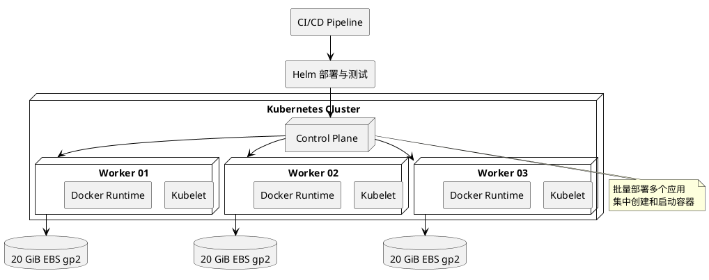
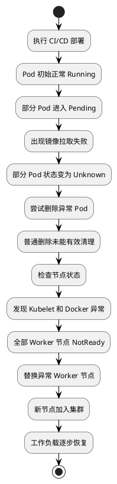
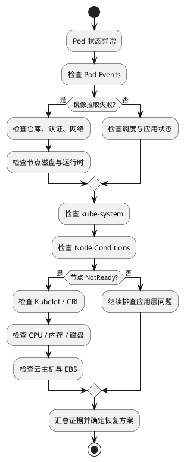
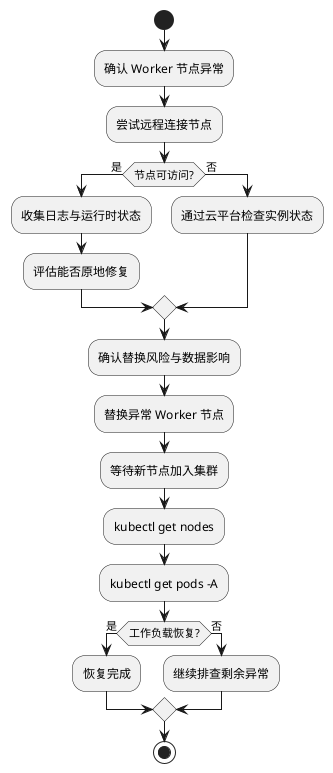
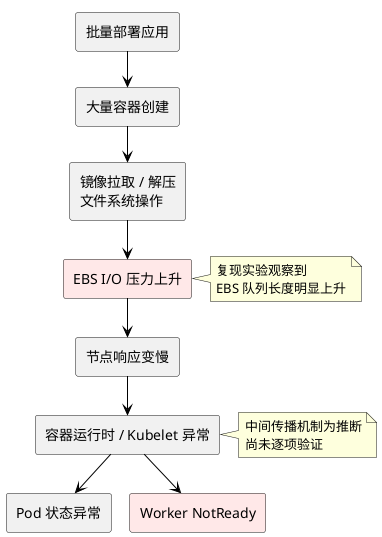
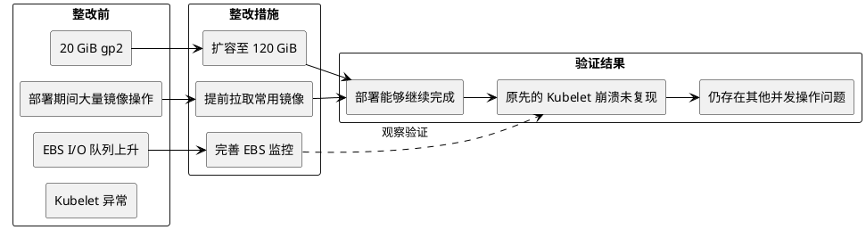
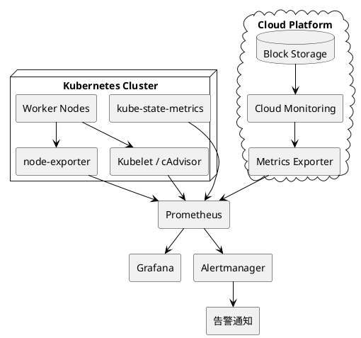
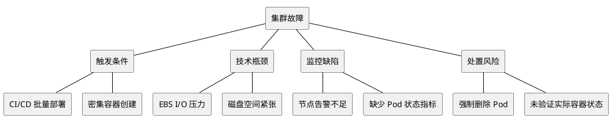

本文复盘一起 Kubernetes 集群在批量部署过程中发生的故障：最初 Pod 正常运行，随后出现 `Pending`、`Unknown` 和镜像拉取失败，最终多个 Worker 节点进入 `NotReady` 状态。

排查发现，节点磁盘 I/O 性能不足是重要的故障因素。通过替换异常节点恢复服务后，又通过监控和复现实验进一步定位了存储瓶颈。

本文采用匿名化案例形式，不保留事故发生时间、原始公司名称及文章来源。技术环境保留与分析相关的必要信息。

## 一、故障背景

某团队使用 Kubernetes 承载开发、测试和持续集成任务。CI/CD 流水线负责构建应用、生成 Helm Chart、部署至 Kubernetes 集群，并运行自动化测试。

集群运行在云平台上，由一个控制平面和三个 Worker 节点组成。每个 Worker 节点使用独立的云块存储作为根磁盘。

| 项目 | 环境配置 |
| --- | --- |
| 集群类型 | Kubernetes 非生产集群 |
| Worker 节点 | 3 台 |
| 部署方式 | CI/CD + Helm |
| 容器运行时 | Docker（事故环境） |
| 节点磁盘 | 20 GiB gp2 云盘 |
| 应用规模 | 数十种容器，部署到多个环境 |
| 监控体系 | 云监控与第三方监控 |

### 1.1 集群部署架构



该架构的主要风险在于：大量容器同时启动时，镜像拉取、解压和文件系统写入可能集中发生，使节点根磁盘成为性能瓶颈。

## 二、故障现象

故障发生在一次常规 CI/CD 部署期间。

部署初期，Pod 能够正常创建并进入 `Running` 状态。但随着部署继续，部分 Pod 状态开始异常，随后问题逐步扩展到 Worker 节点。

### 2.1 故障时间线

以下时间线只保留事件顺序，不展示具体日期或时刻。



### 2.2 Pod 状态异常

执行：

```bash
kubectl get pods -A -o wide
```

可能观察到类似状态：

```text
NAME            READY   STATUS
service-a       1/1     Running
service-b       0/1     Pending
service-c       0/1     Unknown
service-d       0/1     ImagePullBackOff
```

以上为示意输出，并非原始事故日志。

不同状态分别表示不同层面的问题：

- `Pending`：Pod 尚未完成调度或启动准备。
- `Unknown`：控制平面无法可靠获取 Pod 状态。
- `ImagePullBackOff`：容器镜像拉取失败，进入重试等待。这是 `kubectl` 展示的容器等待原因，并非 Pod phase。
- `Running`：Pod 已绑定节点，且至少一个容器正在运行或启动、重启过程中，不代表业务一定健康。

### 2.3 节点状态异常

继续检查：

```bash
kubectl get nodes -o wide
```

```bash
kubectl describe node <node-name>
```

最终发现所有 Worker 节点均进入 `NotReady` 状态。

同时，节点上的 Kubelet 与容器运行时出现健康异常，远程登录也无法正常完成。

此时问题已不再局限于单个应用，而是节点级故障。

## 三、故障排查过程

### 3.1 最初怀疑镜像仓库异常

运维人员通过以下命令检查异常 Pod：

```bash
kubectl describe pod <pod-name> -n <namespace>
```

Events 中存在大量镜像拉取失败信息。

由于此前镜像仓库偶尔出现不稳定情况，加上集群使用的节点规格较低，因此最初判断可能是镜像拉取压力过大。

但镜像拉取失败只是故障现象，尚不能证明问题来自镜像仓库。

### 3.2 尝试删除异常 Pod

为恢复集群，首先尝试删除异常资源：

```bash
kubectl delete pod <pod-name> -n <namespace>
```

命令执行后，部分 Pod 没有按预期消失。

随后尝试强制删除：

```bash
kubectl delete pod <pod-name> \
  -n <namespace> \
  --force \
  --grace-period=0
```

Pod 从 Kubernetes API 中消失，但没有进一步检查节点上的容器是否真正终止。

这是本次故障处置中的一个重要问题。

强制删除 Pod 只意味着 API 对象被移除，不保证失联节点上的容器进程已经停止。对 StatefulSet、有状态应用和共享存储场景，尤其需要避免产生双实例运行或数据一致性风险。

### 3.3 确认故障位于节点层

继续检查系统命名空间：

```bash
kubectl get pods -n kube-system -o wide
```

发现部分系统组件也处于异常状态。

随后检查节点：

```bash
kubectl describe nodes
```

发现容器运行时和 Kubelet 健康检查异常，Worker 节点均无法正常提供服务。

尝试 SSH 登录节点时，连接持续超时。

### 3.4 排查思路



从这个过程可以看出，当多个应用同时异常，并且系统组件也出现问题时，应及时把排查范围从 Pod 扩展到节点和底层基础设施。

## 四、故障恢复

在确认多个 Worker 节点异常且无法远程登录后，运维人员决定替换异常云主机。

具体过程：

1. 终止异常 Worker 实例。
2. 由 Auto Scaling Group 创建新实例。
3. 等待新节点加入 Kubernetes 集群。
4. 验证节点状态及工作负载恢复情况。

新节点加入后，集群恢复正常。

### 4.1 恢复流程



这种方式能够快速恢复非生产环境，但不适合作为所有生产故障的默认处理手段。

在生产环境中，应优先保留诊断证据，确认副本和存储状态，再决定是否执行节点隔离、驱逐或替换。

## 五、根因定位：EBS 磁盘 I/O 瓶颈

恢复集群后，运维人员没有立即结束事故处理，而是重新检查监控体系，并复现部署过程。

此前，云平台监控与第三方监控之间的集成不完整，导致节点异常时没有足够的底层指标用于判断。

修复监控后，重新执行部署，发现：

- EBS I/O 队列长度在部署过程中急剧上升。
- Worker 节点根磁盘容量仅为 20 GiB。
- 磁盘空间使用率约为 90%。
- gp2 磁盘性能与容量相关，较小容量限制了持续 I/O 能力。

这些证据支持磁盘 I/O 是重要瓶颈的判断。

### 5.1 故障传播链



需要区分两类结论：

**已经观察到的事实：** EBS 队列增长、磁盘空间紧张、节点异常，以及调整磁盘和镜像准备方式后不再复现原先的 Kubelet 崩溃。

**合理但未完全验证的推断：** 密集的镜像和容器文件系统操作造成 I/O 等待，进一步影响容器运行时与 Kubelet 的响应能力。

因此，不能简单认定所有异常都由磁盘 I/O 单独造成。仅凭队列长度，也无法确认 gp2 突发额度已经耗尽；还应结合 `BurstBalance`、I/O 延迟、实际 IOPS 和实例 EBS 限额判断。

### 5.2 gp2 性能特点

在传统 AWS EBS gp2 中，基准 IOPS 与卷容量相关，按每 GiB 3 IOPS 计算，最低为 100 IOPS，并存在突发机制。因此，20 GiB gp2 的基准为 100 IOPS，120 GiB 则为 360 IOPS。

小容量 gp2 可以短时间依靠突发额度处理较高负载，但持续密集 I/O 可能受到限制。

事故中的问题不仅是磁盘空间不足，也包括持续部署负载与存储性能之间的不匹配。

## 六、复现实验与整改验证

为了验证存储瓶颈，运维人员调整了节点磁盘配置，并优化镜像准备方式。

### 6.1 实验方案

| 项目 | 调整前 | 调整后 |
| --- | --- | --- |
| 根磁盘容量 | 20 GiB | 120 GiB |
| 存储类型 | gp2 | gp2 |
| 常用镜像 | 部署时按需拉取 | 提前拉取 |
| 监控 | 云磁盘指标不完整 | 增加 EBS 指标 |
| 验证方式 | 正常 CI/CD 部署 | 重复相同部署过程 |

### 6.2 实验结果



实验表明，扩大磁盘容量和提前准备镜像这一组措施改善了部署期间的节点稳定性。由于两项措施同时调整，尚不能单独量化各自的贡献；完善监控则为验证提供了依据。

但在后续测试中，集群仍出现其他问题，因此不能认为所有故障已经彻底解决。

## 七、现代 Kubernetes 整改方案

原始事故环境使用 Docker 作为容器运行时。对于现代 Kubernetes 集群，通常应围绕 containerd、CRI、Kubelet、节点存储和 CI/CD 并发控制进行优化。

### 7.1 存储与节点资源优化

建议从以下方面着手：

- 评估使用 gp3 等支持独立配置性能的云盘。
- 为容器镜像、日志和临时文件预留足够空间。
- 设置合理的 `systemReserved`、`kubeReserved` 和 Eviction 阈值。
- 监控磁盘容量、inode、I/O 延迟、吞吐和队列长度。
- 根据实际负载决定是否预拉取常用镜像。

### 7.2 CI/CD 并发控制

部署流水线不应无限制地同时创建工作负载。

可以限制同一集群内的并发部署任务，并结合 Deployment 滚动更新参数控制更新速度。

例如，下面是 Deployment 的配置片段，需合并到包含 `selector` 和 Pod `template` 的完整清单中：

```yaml
apiVersion: apps/v1
kind: Deployment
metadata:
  name: example-app
spec:
  replicas: 6
  strategy:
    type: RollingUpdate
    rollingUpdate:
      maxSurge: 1
      maxUnavailable: 1
```

这些参数控制单个 Deployment 的滚动更新，不等于对整个集群的 Pod 创建进行全局限流。

### 7.3 监控架构



重点关注：

| 监控对象 | 核心指标 |
| --- | --- |
| Node | Ready、DiskPressure、MemoryPressure |
| Pod | Pending、Unknown、重启次数 |
| Kubelet | 运行时操作延迟、错误、健康状态 |
| 磁盘 | 可用空间、inode、I/O 延迟 |
| EBS | IOPS、吞吐、队列长度、gp2 BurstBalance |
| CI/CD | 并发部署数量、部署失败率 |

### 7.4 现代化故障排查命令

以下命令按排查对象分组执行；`journalctl`、`crictl` 和磁盘命令需在对应节点上运行：

```bash
# 集群状态
kubectl get nodes -o wide
kubectl get pods -A -o wide

# 节点详情
kubectl describe node <node-name>

# Kubelet 日志
journalctl -u kubelet -n 200 --no-pager

# containerd 日志
journalctl -u containerd -n 200 --no-pager

# 容器运行时
crictl ps -a
crictl images

# 磁盘
df -h
df -i
iostat -xz 1
```

排查时应先确认异常范围，再结合节点日志、容器运行时和云平台指标进行关联分析，而不是直接重启所有 Pod。

## 八、事故总结

这次故障的特点在于，触发事件并不是复杂的系统变更，而是一次常规的批量部署。

故障初期表现为 Pod 状态异常和镜像拉取失败，但最终影响了整个 Worker 节点层。恢复节点后，通过补充监控和重复实验，才发现 EBS I/O 性能不足这一重要问题。

### 8.1 故障因素分类



### 8.2 关键经验

**第一，部署操作本身就是一种资源负载。** 大量容器同时创建时，节点需要处理镜像、文件系统、网络和运行时操作，不能只根据应用稳定运行时的资源使用量评估集群容量。

**第二，Pod 异常不一定是应用问题。** 当多个应用同时出现异常，尤其伴随系统组件和节点状态异常时，应优先排查基础设施。

**第三，磁盘性能和磁盘容量同样重要。** 即使磁盘尚未写满，也可能因为 IOPS、吞吐或延迟限制影响节点正常运行。

**第四，监控必须覆盖底层依赖。** 只有 CPU 和内存指标不足以解释所有 Kubernetes 故障，还需要节点、容器运行时和云存储的可观测数据。

**第五，恢复与根因修复应分开处理。** 替换节点能够恢复服务，但只有复现故障、分析证据并验证整改，才能降低再次发生的风险。

## 九、结论

这起事故体现了 Kubernetes 集群中的一个典型问题：应用部署产生的瞬时资源压力，可能超过节点底层存储的承载能力，并进一步影响容器运行时与 Kubelet 的稳定性。

最终通过扩容磁盘、提前拉取镜像和完善监控，原先的 Kubelet 崩溃不再复现，但集群仍需继续优化并发部署能力。

对于生产环境，最有价值的改进不是在节点失联后更快地重建实例，而是提前发现资源瓶颈、限制部署冲击，并建立完整的节点故障诊断与恢复流程。

本文为真实技术事故的匿名化整理与现代化复盘。为保护案例信息，省略原始公司、作者、发布日期；示例命令和现代化整改建议属于补充分析，不代表事故现场全部实际操作。

