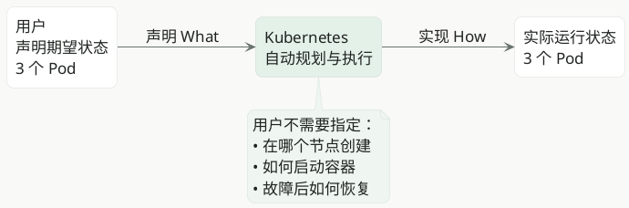
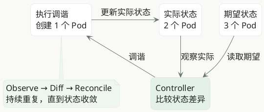
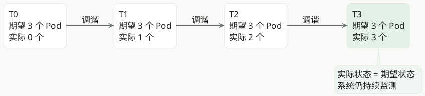
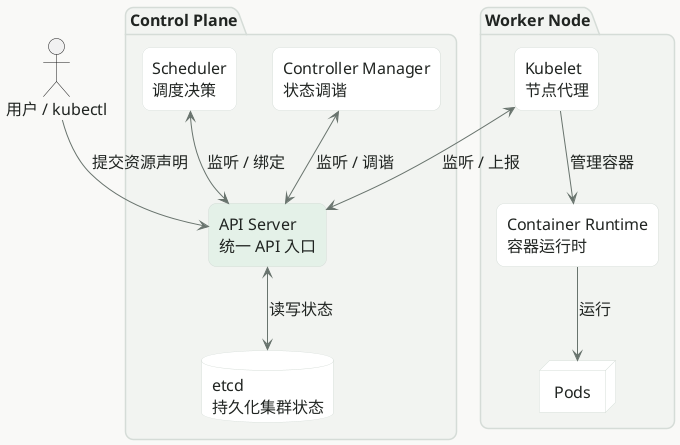
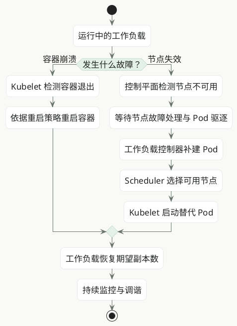
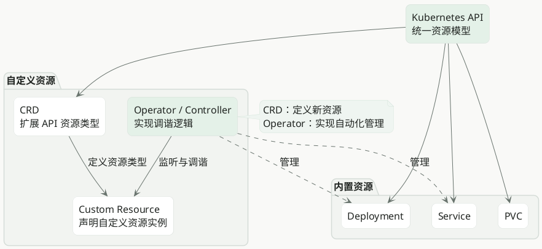
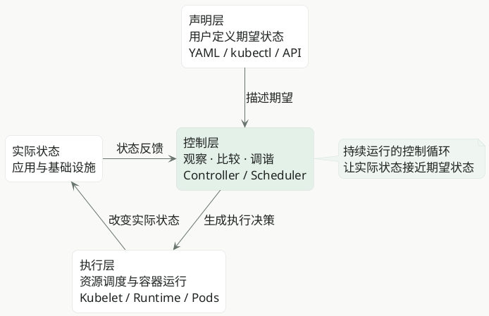

Kubernetes 的核心思想：声明期望状态，通过控制循环，让实际状态持续接近期望状态。

## 一、声明式管理（Declarative）

只描述目标，不关心具体执行步骤。

## 二、控制循环（Reconciliation Loop）

这是 Kubernetes 最核心的运行机制。

## 三、最终一致性（Eventual Consistency）

Kubernetes 不保证立即达到目标，而是通过异步调谐逐步收敛。

## 四、松耦合与模块化（Loose Coupling）

Kubernetes 将状态存储、调谐、调度和节点执行分离，各组件围绕 API Server 协作。

## 五、面向故障设计（Design for Failure）

Kubernetes 假设故障不可避免，通过检测与调谐恢复服务能力。

## 六、抽象与可扩展性（Abstraction & Extensibility）

Kubernetes 提供统一资源模型，同时允许用户通过 CRD 和 Operator 扩展新的管理能力。

## 七、Kubernetes 整体设计思想

## 总结

- 声明式管理：定义目标。
- 控制循环：持续调谐。
- 最终一致性：逐步收敛。
- 模块化：职责分离。
- 面向故障：检测与恢复。
- 可扩展性：统一抽象，按需扩展。

六大理念共同构成 Kubernetes 的核心：以状态为中心，通过持续反馈与自动调谐管理分布式系统。
