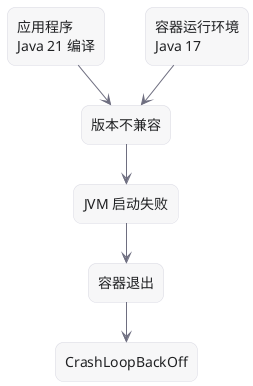
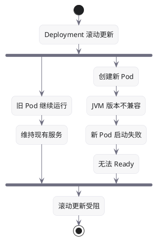
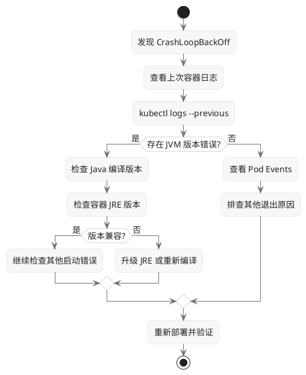
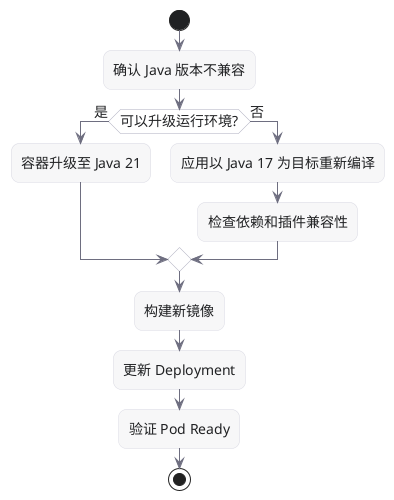

故障原因：Java 编译版本与容器运行版本不兼容。

- 应用编译版本：Java 21
- 容器运行版本：Java 17
- 故障结果：JVM 启动失败，容器反复重启
- 旧 Pod 正常：可能仍在运行旧版本镜像

## 1. 故障现象

```text
Deployment
├── Pod A   Running
└── Pod B   CrashLoopBackOff
```

新 Pod 的关键错误：

```text
UnsupportedClassVersionError

class file version 65.0
runtime supports up to 61.0
```

## 2. 故障架构图

```plantuml
@startuml
skinparam backgroundColor #FFFFFF
skinparam shadowing false
skinparam roundcorner 16
skinparam defaultFontName "SansSerif"
skinparam defaultFontSize 14
skinparam defaultFontColor #202123
skinparam ArrowColor #6E6E80
skinparam ArrowThickness 1
skinparam nodesep 40
skinparam ranksep 40
skinparam rectangle {
  BackgroundColor #F7F7F8
  BorderColor #D9D9E3
  FontColor #202123
}
skinparam activity {
  BackgroundColor #F7F7F8
  BorderColor #D9D9E3
  FontColor #202123
  DiamondBackgroundColor #FFFFFF
  DiamondBorderColor #ACACBE
  DiamondFontColor #202123
  StartColor #202123
  EndColor #202123
  BarColor #6E6E80
}

top to bottom direction

rectangle "Deployment" as D
rectangle "旧 ReplicaSet" as R1
rectangle "新 ReplicaSet" as R2
rectangle "Pod A\nRunning" as P1
rectangle "Pod B\nCrashLoopBackOff" as P2

D --> R1
D --> R2
R1 --> P1
R2 --> P2

@enduml
```



## 3. 根本原因



Java 字节码版本对应关系：

| Java 版本 | Class File Version |
| ------- | ------------------ |
| Java 17 | 61                 |
| Java 21 | 65                 |

Java 17 无法直接运行 Java 21 编译的字节码。

## 4. 为什么旧 Pod 正常？



注意：旧 Pod 继续正常运行，可能是滚动更新保留了旧实例。该解释尚未通过 Deployment 配置、ReplicaSet 归属和镜像信息确认。

## 5. 排查流程



## 6. 常用排查命令

```bash
# 查看 Pod 状态
kubectl get pods -o wide

# 查看上次崩溃日志
kubectl logs <pod-name> --previous

# 查看 Pod 事件
kubectl describe pod <pod-name>

# 查看 ReplicaSet
kubectl get rs

# 查看 Deployment 更新状态
kubectl rollout status deployment/<name>

# 比较实际镜像
kubectl get pods -o custom-columns=\
NAME:.metadata.name,\
IMAGE:.spec.containers[*].image,\
IMAGE_ID:.status.containerStatuses[*].imageID
```

## 7. 修复方案



## 8. 最终总结

| 维度 | 结论 |
| -------- | ---------------------- |
| 故障表现 | 新 Pod CrashLoopBackOff |
| 直接原因 | JVM 无法加载较新版本的字节码 |
| 可能的变更问题 | 镜像 JRE 或应用编译目标不一致 |
| 旧 Pod 正常 | 可能是滚动更新保留旧实例 |
| 解决方向 | 统一 Java 编译与运行版本 |
| 核心经验 | 优先检查崩溃日志，而不是盲目重启 Pod |

一句话总结：CrashLoopBackOff 是结果，Java 版本不兼容才是本案例日志明确揭示的故障原因。
