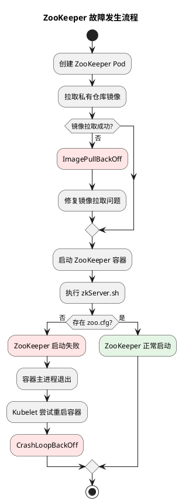
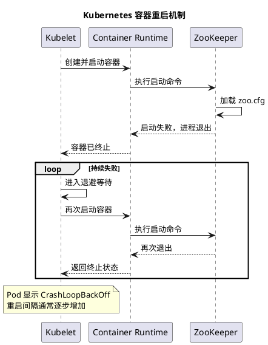
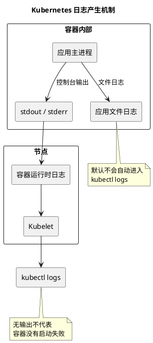
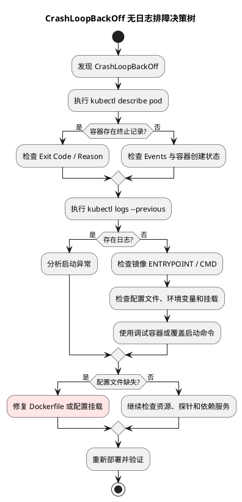
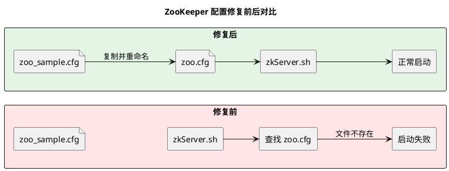
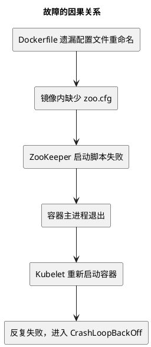

## 一、真实故障总结

在 Kubernetes 中部署 ZooKeeper 时，遇到了两个连续的问题：

1. 最初 Pod 状态为 `ImagePullBackOff`，镜像无法正常拉取。
2. 修复镜像拉取问题后，状态变为 `CrashLoopBackOff`。
3. 执行 `kubectl logs` 和 `kubectl logs -p`，均没有日志输出。
4. 最终发现 Dockerfile 中没有将 `zoo_sample.cfg` 重命名为 `zoo.cfg`，导致 ZooKeeper 启动失败。

真正的根因是容器启动依赖的配置文件缺失，而不是 Kubernetes 本身发生故障。

## 二、故障发生流程



## 三、理解 CrashLoopBackOff 的机制

`CrashLoopBackOff` 并不是某个具体的应用错误，而是 Kubernetes 对容器反复退出、重启进入退避等待状态的描述。



关键是区分两个概念：

- **容器退出**：容器的主进程结束，可能是正常退出，也可能是异常退出。
- **CrashLoopBackOff**：容器不断退出并被重启，Kubelet 暂时延迟下一次启动。

是否重启还取决于 Pod 的重启策略。对于通常使用 `restartPolicy: Always` 的工作负载，即使主进程正常退出，也可能在反复重启后进入退避等待。

## 四、为什么 kubectl logs 没有输出？

`kubectl logs` 主要读取容器的标准输出 `stdout` 和标准错误 `stderr`。

如果应用没有向这两个流写入内容，日志就可能为空。



本案例没有证据确定日志为空的具体技术原因，但已确认配置文件缺失是启动失败的根因。不能仅凭日志为空，就推断应用一定将日志写入了文件。

另外，`kubectl logs` 命令返回退出码 `0`，只说明日志读取请求成功完成，不代表应用正常运行。

## 五、标准排障决策树



## 六、实际排查命令

### 第一步：检查 Pod 状态与事件

```bash
kubectl describe pod zookeeper-n1-pod-0 -n test-1
```

重点观察：

- `State`：容器当前状态。
- `Last State`：上一次终止状态。
- `Reason`：例如 `Error`、`OOMKilled`。
- `Exit Code`：主进程退出码。
- `Events`：容器启动、探针失败、重启等事件。

### 第二步：查看上一次容器日志

```bash
kubectl logs zookeeper-n1-pod-0 \
  -n test-1 \
  -c zookeeper-n1 \
  --previous
```

`--previous` 用于读取上一个已终止容器实例的日志，而不是当前实例的日志。若没有可用的上一次实例或日志已不可用，命令也可能返回错误，需要结合状态与事件继续判断。

### 第三步：检查启动配置

对于本案例，重点检查 ZooKeeper 的配置文件。在能够进入的调试容器或镜像检查环境中执行：

```bash
ls -l /conf/zoo.cfg
```

实际路径应根据镜像内的 ZooKeeper 安装位置确定。

也可以在临时调试用的工作负载副本中覆盖启动命令：

```yaml
command: ["/bin/bash", "-c", "--"]
args:
  - "while true; do sleep 30; done;"
```

这样可以让容器暂时保持运行，以便检查文件和环境，但需要镜像中存在 `/bin/bash`。这只是调试手段，不是修复方案；检查完成后应恢复原始启动命令。

## 七、根因与修复方案



问题出在 Dockerfile 构建阶段遗漏了配置文件重命名操作。

可以根据镜像实际路径添加类似命令：

```dockerfile
RUN cp /opt/zookeeper/conf/zoo_sample.cfg \
       /opt/zookeeper/conf/zoo.cfg
```

路径仅为示例，应以实际镜像为准。ZooKeeper 启动脚本需要找到预期的 `zoo.cfg`，否则无法按预期启动。

复制示例配置解决的是配置文件缺失问题。实际部署还需要按环境设置数据目录、监听地址及集群成员等参数；如果通过 ConfigMap 或卷提供配置，也应确认挂载路径、文件名和读取权限。

修复后重新构建镜像、更新工作负载，并检查 Pod 是否持续处于就绪状态、重启次数是否停止增长，以及 ZooKeeper 是否能正常提供服务。

## 八、这个案例需要掌握的 Kubernetes 知识

| 知识点 | 核心结论 |
| --- | --- |
| ImagePullBackOff | 镜像拉取失败后进入重试等待 |
| CrashLoopBackOff | 容器反复退出，重启受到退避限制 |
| Kubelet | 负责协调节点上的容器启动和重启 |
| Container Runtime | 执行容器创建、启动和终止 |
| kubectl logs | 读取容器 stdout/stderr 日志 |
| kubectl describe | 查看容器状态、退出原因和事件 |
| ENTRYPOINT / CMD | 定义镜像默认启动进程，可被 Pod 的 command / args 覆盖 |
| Dockerfile | 镜像构建错误可能导致运行时启动失败 |

## 九、最终总结



这个真实案例最重要的工程经验是：

**CrashLoopBackOff 是故障表现，不是根因；日志为空也不意味着没有故障。**

正确的排障顺序应当是：

`Pod 状态 → 容器终止原因 → Events → 上一次容器日志 → 启动命令 → 配置文件 → 镜像构建过程`

对于 Kubernetes 工程师而言，这类故障真正考验的是能否把 Kubernetes 的容器生命周期与 Linux 进程、镜像构建、应用启动机制联系起来，而不只是记住 `kubectl` 命令。
