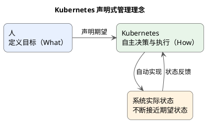

Kubernetes 的第一个核心设计理念是：关注目标，而不是过程。

传统的命令式管理强调如何完成任务，由人规划步骤、执行操作并处理过程中出现的问题。

声明式管理则由用户描述系统期望达到的状态。至于如何实现、如何调整以及如何维持这一状态，由系统自行完成。

## 声明式管理理念图

## 三个核心思想

### 1. 目标与执行分离

人负责定义目标，系统负责实现目标。

### 2. 从过程控制转向状态管理

不再逐步指定具体操作，而是关注系统的实际状态是否符合预期。

### 3. 从人工干预转向自动化自治

系统根据状态变化持续调整，无需依赖人工反复操作。

## 本质

声明式管理改变了人与计算机系统的协作方式。

人通过描述期望状态来表达意图，不必直接控制每一个执行步骤。系统则负责完成实现目标所需的复杂操作。

执行过程中的复杂性由使用者转移到系统内部：人负责定义目标，系统负责实现目标。
