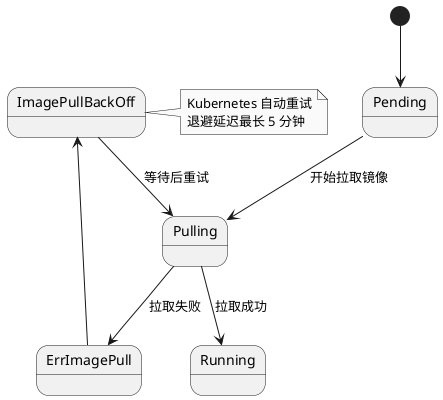
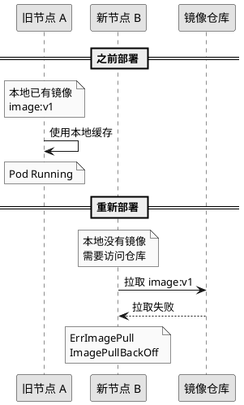
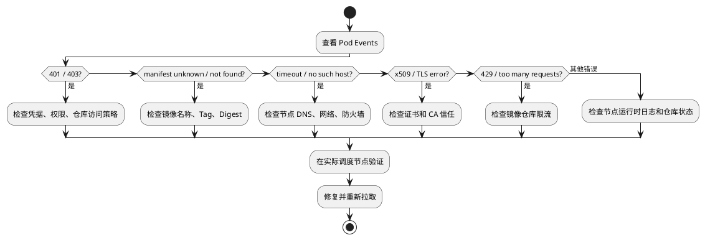
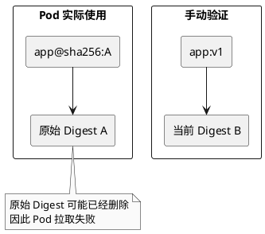
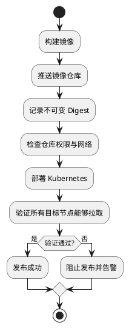

核心原因：之前部署成功，不代表现在还能从镜像仓库拉取相同的镜像。

旧 Pod 可能使用了节点上的镜像缓存，而新 Pod 需要重新访问仓库。此时只要镜像、认证、网络或仓库状态发生变化，就可能出现 `ImagePullBackOff`。

## 1. ImagePullBackOff 是什么？

`ImagePullBackOff` 表示 Kubernetes 拉取镜像失败，正在等待下一次重试。

图 1 · Pod 镜像拉取状态



这是镜像拉取过程的简化示意；`Pulling` 是事件原因，`ErrImagePull` 和 `ImagePullBackOff` 是容器等待原因，并非 Pod phase。镜像拉取成功后，容器还需要完成创建和启动。

注意：这与 `CrashLoopBackOff` 不同。

- `ImagePullBackOff`：镜像无法拉取，受影响的容器无法完成本次启动。
- `CrashLoopBackOff`：容器已经启动过，但反复退出。

## 2. 为什么之前可以运行？

最容易忽略的是**节点本地缓存**和**实际镜像拉取**之间的区别。

图 2 · 旧节点正常，新节点拉取失败



可能发生了以下变化：

- 镜像标签被覆盖，或者对应的 Digest 已删除。
- 私有仓库的认证凭据过期。
- Pod 被调度到了没有镜像缓存的新节点。
- 节点无法连接镜像仓库。
- 仓库限流或发生故障。

另外，当 `imagePullPolicy: Always` 时，即使镜像层已有缓存，启动容器时仍需要通过仓库检查镜像引用；`IfNotPresent` 则可以在本地已有所需镜像时跳过拉取。

## 3. 如何快速定位？

不要只看 `Back-off pulling image`，真正的错误通常在前面的 `Failed to pull image` 事件中。

首先执行：

```bash
kubectl describe pod <pod-name> -n <namespace>
```

查看 `Events` 部分。

图 3 · ImagePullBackOff 排查决策树



常见错误对应关系：

| Events 错误 | 可能原因 |
| --- | --- |
| `unauthorized` | 认证失败 |
| `manifest unknown` | 镜像 Tag 或 Digest 不存在 |
| `pull access denied` | 仓库不存在或没有权限 |
| `i/o timeout` | 节点网络不通 |
| `no such host` | DNS 解析失败 |
| `x509` | 证书验证失败 |
| `429 Too Many Requests` | 仓库请求限流 |
| `unknown blob` | 镜像层缺失或仓库存储异常 |

## 4. 特别容易误判：本地 docker pull 成功

假设 Pod 使用：

```text
registry.example.com/app@sha256:abc123...
```

但是你验证的是：

```bash
docker pull registry.example.com/app:v1
```

这两个镜像引用不一定对应同一个版本。

图 4 · Tag 与 Digest 不一致



所以，即使本机 `docker pull` 成功，也不能证明 Pod 能成功拉取。

必须检查两个条件：

1. 是否使用了 Pod 中完全相同的镜像地址，包括 Digest。
2. 是否在 **Pod 实际调度的节点**上验证，而不是其他机器。

验证时还应对齐容器运行时、认证信息、代理和 CA 信任配置；同一节点上的 Docker 与 Kubernetes 使用的 CRI 运行时也可能采用不同配置。

## 5. 最短排障命令

```bash
# 1. 查看具体拉取失败原因
kubectl describe pod <pod-name> -n <namespace>

# 2. 查看 Pod 调度在哪台节点
kubectl get pod <pod-name> -n <namespace> -o wide

# 3. 查看实际镜像与拉取策略
kubectl get pod <pod-name> -n <namespace> -o yaml

# 4. 检查私有仓库 Secret 是否存在
kubectl get secret -n <namespace>
```

如果是 OpenShift，将 `kubectl` 替换为 `oc`。

在故障节点上还可以使用：

```bash
# 查看节点本地镜像
sudo crictl images

# 测试实际镜像拉取
sudo crictl pull <完整镜像地址>
```

注意，`crictl pull` 不一定会自动使用 Pod 的 `imagePullSecrets`。测试私有仓库时需要提供适当凭据，否则手动拉取失败也不能直接证明 Pod 的认证配置有问题。

## 6. 如何防止再次发生？

图 5 · 从构建到部署的镜像可靠性



生产环境建议：

- 使用固定版本或 Digest，避免反复覆盖 `latest`。
- 保证部署所依赖的镜像不会被仓库清理策略提前删除。
- 管理好镜像仓库凭据，避免使用会意外过期的临时 Token。
- 在发布前验证实际运行节点的镜像拉取能力。
- 对 `ErrImagePull`、`ImagePullBackOff` 设置监控告警。

## 故障总结

`ImagePullBackOff` 本身不是根因，只是镜像拉取失败后的重试状态。

最重要的三步：

1. `kubectl describe pod`：找到真正的错误。
2. `kubectl get pod -o wide`：确认失败发生在哪台节点。
3. 使用 Pod 中的完整镜像引用，在对应节点验证拉取。

核心原则：不要因为镜像以前部署成功，或者本机能够 `docker pull`，就认定镜像仓库没有问题。

## 参考资料

- [Kubernetes：镜像与镜像拉取策略](https://kubernetes.io/docs/concepts/containers/images/)
- [Kubernetes：使用 crictl 调试节点](https://kubernetes.io/docs/tasks/debug/debug-cluster/crictl/)
