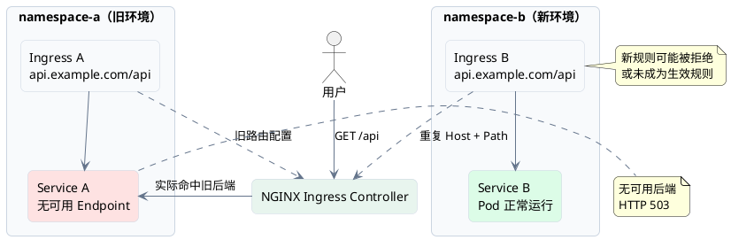
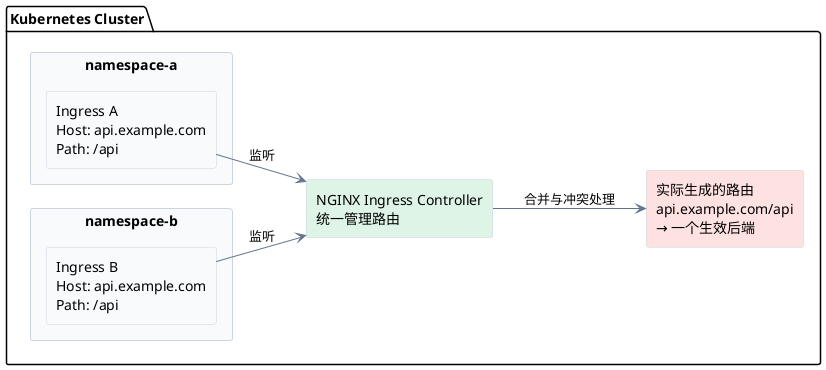
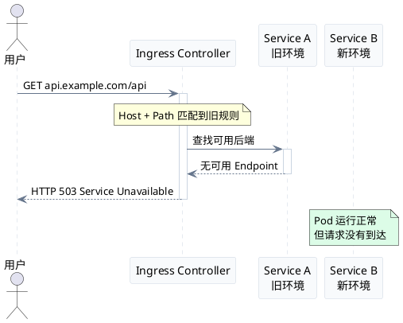
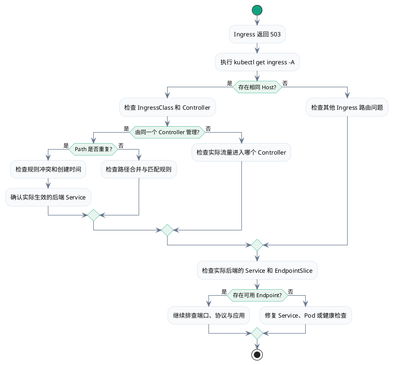
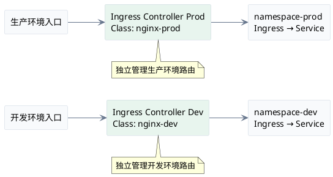

> **核心问题：** 不同 Namespace 的 Ingress 使用相同的 Host 和 Path，可能导致请求命中错误的后端 Service，最终返回 HTTP 503。

## 一、故障现象

某 Kubernetes 集群部署了两个应用：

- `namespace-a`：旧应用，已经停止运行。
- `namespace-b`：新应用，Pod 和 Service 均正常。

两个 Namespace 都配置了相同的域名 `api.example.com` 和路径 `/api`。

用户访问新应用时，却收到：

```text
HTTP/1.1 503 Service Unavailable
```

检查发现：

- 新应用 Pod 状态为 Running。
- Service 配置正常。
- Service 存在可用 Endpoint。
- 直接访问 Service 正常。
- 通过 Ingress 访问返回 503。

### 故障架构



**问题不在新应用，而在于请求没有到达新应用。**

---

## 二、为什么 Namespace 无法隔离 Host？

Kubernetes Namespace 用于隔离资源名称和管理范围，但不意味着网络域名天然隔离。

一个 Ingress Controller 可以监听多个 Namespace 中的 Ingress，并将它们合并为统一的 NGINX 路由配置。

### Ingress 的路由机制



这里的关键不是 Namespace 是否相同，而是：

**两个 Ingress 是否被同一个 Controller 管理，以及 Host 和 Path 是否冲突。**

### ingress-nginx 的路由处理规则

| 情况 | 处理结果 |
|---|---|
| Host 不同 | 独立匹配 |
| Host 相同，Path 不同 | 通常合并为同一 Host 的不同路径 |
| Host 相同，Path 相同 | 发生规则冲突 |
| 不同 IngressClass | 通常由不同 Controller 管理 |

社区版 ingress-nginx 的路由合并逻辑中，重复 Host + Path 时，较早创建的规则优先。但启用了验证机制的集群可能直接拒绝后创建的冲突规则。

---

## 三、503 是如何产生的？

需要明确：

**Host 冲突不直接等于 HTTP 503。**

503 通常发生在生效路由指向的后端没有可用 Endpoint，或后端 Service 不存在等情况下。

### 请求失败时序图



完整的故障链路：

```text
重复 Host + Path
       ↓
路由规则冲突
       ↓
旧 Ingress 规则仍然生效
       ↓
请求指向旧 Service
       ↓
旧 Service 无可用 Endpoint
       ↓
HTTP 503
```

即使新应用完全正常，只要实际匹配的是旧 Service，请求仍然可能失败。

---

## 四、如何快速定位？

### 1. 检查所有 Namespace 的 Ingress

```bash
kubectl get ingress -A
```

筛选目标域名：

```bash
kubectl get ingress -A | grep api.example.com
```

假设输出：

```text
NAMESPACE     NAME          HOSTS
namespace-a   old-ingress   api.example.com
namespace-b   new-ingress   api.example.com
```

发现重复 Host 后，继续检查 Path，而不是立即认定冲突。

### 2. 检查 Ingress 路由详情

```bash
kubectl describe ingress old-ingress -n namespace-a
```

```bash
kubectl describe ingress new-ingress -n namespace-b
```

重点检查：

- `IngressClass`
- `Host`
- `Path`
- `Backend Service`
- 创建时间
- Events 中是否存在规则冲突或验证失败

### 3. 检查旧 Service 是否存在可用后端

```bash
kubectl get svc -n namespace-a
```

```bash
kubectl get endpointslice -n namespace-a
```

也可以检查传统 Endpoints 资源：

```bash
kubectl get endpoints -n namespace-a
```

如果实际生效的 Service 没有可用 Endpoint，就找到了 503 的重要原因。

### 4. 检查 Ingress Controller 日志

```bash
kubectl logs -n ingress-nginx \
  deploy/ingress-nginx-controller \
  --tail=200
```

重点查找配置冲突、后端不可用、Service 不存在等信息。

也可以查看 NGINX 生成的配置，确认请求最终映射到了哪个后端。

### 故障排查流程图



---

## 五、如何解决？

### 方案一：使用不同 Host（推荐）

不同环境采用不同域名：

```text
namespace-a
  └── old.example.com
        └── Service A

namespace-b
  └── api.example.com
        └── Service B
```

优点是路由清晰、维护简单，不容易产生跨环境冲突。

### 方案二：相同 Host，使用不同 Path

如果业务必须共享域名：

```text
api.example.com
    │
    ├── /service-a → namespace-a / Service A
    │
    └── /service-b → namespace-b / Service B
```

不同 Path 可以被同一个 ingress-nginx Controller 合并。

但要注意路径匹配以及 Rewrite、正则表达式等相关配置的影响。

### 方案三：独立 Ingress Controller

对于需要严格隔离的环境，可以分别部署 Ingress Controller，使用不同的 IngressClass 和独立流量入口。



需要注意，仅配置不同 IngressClass 还不够，必须确认 Controller 的监听范围及外部流量入口也实现了隔离。

---

## 六、总结

Ingress 503 排查中一个容易忽视的问题，是**只检查当前 Namespace，而忽略其他 Namespace 的 Ingress 配置**。

三个关键结论：

1. **Namespace 不等于域名隔离。** 同一个 Ingress Controller 可以管理多个 Namespace。
2. **Host 相同不一定冲突。** 需要同时检查 Path、IngressClass 和实际 Controller。
3. **路由冲突不一定返回 503。** 503 的直接原因通常需要进一步结合实际生效的 Service 和 Endpoint 判断。

最值得优先执行的一条命令：

```bash
kubectl get ingress -A
```

当 Pod 正常、Service 正常，但通过 Ingress 访问异常时，应该从整个 Controller 的路由视角排查，而不只是查看当前 Namespace。

**核心经验：排查 Ingress 故障，不仅要确认目标 Service 是否健康，更要确认请求实际到达的是哪个 Service。**
