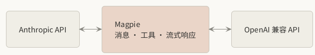
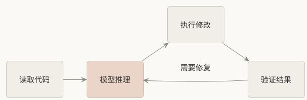
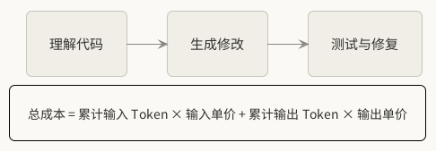
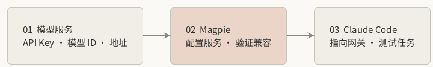

claude封的太快了实在用不起，本文提供了一种低成本使用claude code的方法，将deepseek模型通过协议转换的方式接入Claude code，网关会将cc完整上下文传递给底层模型，使得国产模型也可以获得完整的cc能力的同时大幅降低了使用成本

## 一、核心思路

Claude Code 负责代码开发和工具调用，Magpie 负责模型接口转换，DeepSeek 4.1 Flash 负责模型推理。

```plantuml
@startuml
!theme plain
skinparam backgroundColor #FAF9F5
skinparam defaultFontName "Noto Sans CJK SC"
skinparam defaultFontSize 15
skinparam defaultFontColor #30302E
skinparam shadowing false
skinparam roundCorner 12
skinparam padding 16
skinparam nodesep 40
skinparam ranksep 45
skinparam ArrowColor #87867F
skinparam ArrowThickness 1
skinparam rectangle {
  BackgroundColor #F0EEE6
  BorderColor #C8C5BB
  BorderThickness 1
}
hide stereotype
left to right direction

rectangle "Claude Code\n读取 · 执行" as CC
rectangle "Magpie\n协议转换" as M #EAD5C8
rectangle "DeepSeek 4.1 Flash\n推理" as DS
CC <--> M
M <--> DS
@enduml
```

这样无需更换 Claude Code，只需要修改模型请求的接入方式。

## 二、为什么需要 Magpie？

Claude Code 与第三方模型服务使用的 API 协议可能不同。

例如，Claude Code 使用 Anthropic 风格的消息接口，而第三方模型服务可能提供 OpenAI 兼容接口。

Magpie 在中间承担适配工作。

需要注意，协议适配不仅是修改接口地址，还可能涉及工具调用、流式输出、消息结构等兼容问题。

## 三、一次代码修改如何完成？

假设让 Claude Code 修改一个项目中的 Bug。

整个过程可以理解为：

**关键区别：模型负责推理，Claude Code 负责实际执行。**

即使替换底层模型，Claude Code 的文件操作、终端命令和项目开发流程仍然可以继续使用，前提是接口和工具调用兼容。

## 四、成本为什么可能降低？

Claude Code 的开发任务往往不止调用一次模型。

一次任务可能包含：

- 阅读项目文件和理解上下文
- 分析问题并生成修改方案
- 调用工具修改代码
- 根据测试结果再次修复

模型调用次数越多，Token 成本越值得关注。

如果 DeepSeek 4.1 Flash 的实际输入、输出 Token 单价低于原模型，并且能够以相近的调用次数完成任务，就有机会降低总体开发成本。

但便宜不一定意味着最终成本最低。还需要考虑工具调用成功率、模型输出质量，以及因失败重试产生的额外消耗。

## 五、实际接入思路

整个接入过程可以简化为三个步骤：

1. 准备 DeepSeek 4.1 Flash 的 API Key、模型 ID 和接口地址。
2. 在 Magpie 中配置模型服务，确认请求转换和工具调用兼容。
3. 将 Claude Code 的模型请求指向 Magpie，运行一个简单的代码修改任务验证。

具体环境变量、模型 ID 和接口参数需要以实际使用的 Magpie 版本及模型服务商文档为准。

## 六、总结

通过 Magpie 接入 DeepSeek 4.1 Flash，本质上是将 **AI 编程工具与底层模型解耦**。

Claude Code 继续提供成熟的 Agent 开发环境，Magpie 解决模型接口兼容问题，DeepSeek 4.1 Flash 承担推理任务。

这种方案适合希望继续使用 Claude Code，同时尝试降低日常 AI 编程 Token 开销的开发者。

最终是否值得长期使用，取决于三个因素：**模型成本、工具调用兼容性和实际开发成功率。**
