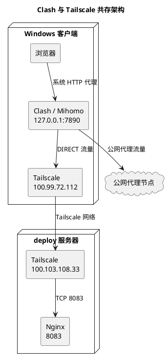
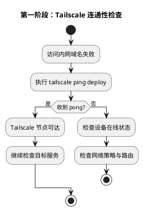
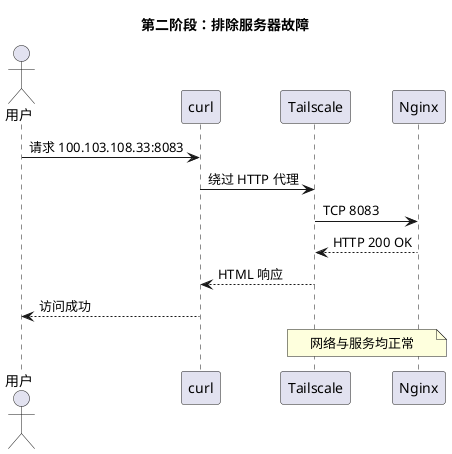
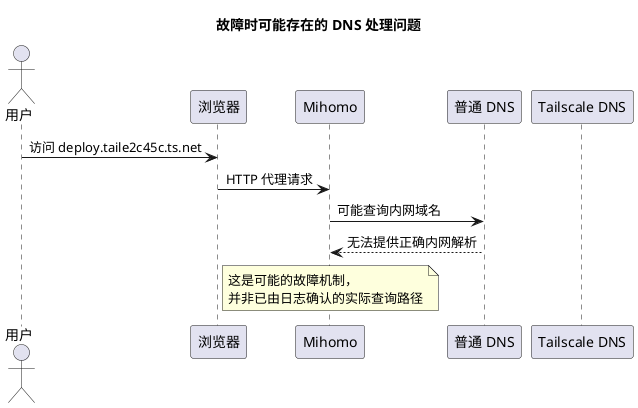
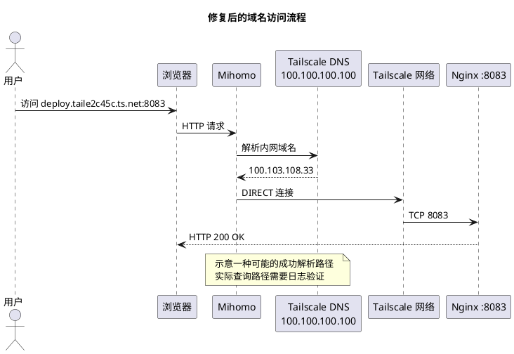
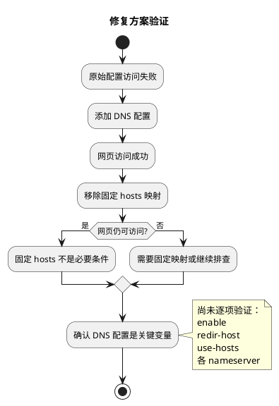
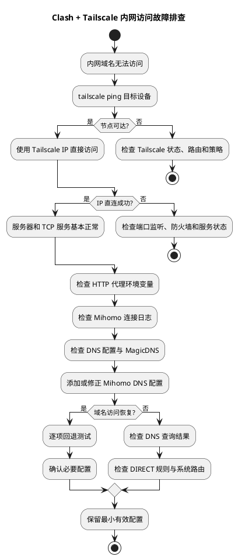
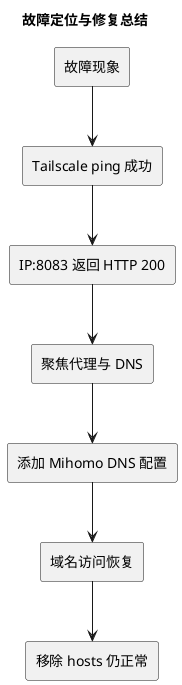

> 故障现象：Windows 同时运行 Clash/Mihomo 和 Tailscale，Tailscale 节点通信正常，内网服务 IP 可以访问，但通过 MagicDNS 域名访问失败。最终通过调整 Mihomo DNS 配置解决。

## 一、故障背景

在 Windows 环境中，同时运行 Clash Verge Rev（Mihomo 内核）和 Tailscale。

Clash 使用系统代理模式，负责公网代理访问；Tailscale 负责设备之间的虚拟专用网络连接。

访问以下服务时出现异常：

```text
http://deploy.taile2c45c.ts.net:8083/
```

环境信息：

| 组件 | 配置 |
| --- | --- |
| 操作系统 | Windows 11 |
| 代理客户端 | Clash Verge Rev / Mihomo |
| 代理模式 | Rule + 系统代理 |
| 本地代理端口 | 7890 |
| 组网工具 | Tailscale |
| 目标设备 | deploy |
| Tailscale IP | `100.103.108.33` |
| 服务端口 | 8083 |
| Web 服务 | Nginx |

故障特点是：关闭 Clash 后可以访问，开启 Clash 后无法通过域名访问。

这意味着故障很可能与代理或 DNS 处理有关，但仍需要逐层验证。

## 二、网络架构与故障位置



这里存在两个不同的网络机制：

- Clash/Mihomo：决定请求使用代理节点还是直连，同时可能参与 DNS 解析。
- Tailscale：负责虚拟网络连接，并通过 MagicDNS 提供设备名称解析。

即使 Tailscale 隧道正常，Mihomo 仍可能因为域名解析或代理处理方式导致访问失败。

## 三、故障排查过程

### 1. 检查 Tailscale 连通性

首先执行：

```powershell
tailscale ping deploy
```

实际输出：

```text
pong from deploy (100.103.108.33)
via 94.249.172.46:41641 in 242ms
```

说明客户端能够通过 Tailscale 联系到目标设备。



结论：Tailscale 节点可达，但不能仅凭 ping 成功就认定 Web 服务正常。

### 2. 检查请求是否经过代理

使用 curl 请求内网服务：

```powershell
curl.exe -v http://deploy.taile2c45c.ts.net:8083/
```

观察到：

```text
Uses proxy env variable http_proxy == 'http://127.0.0.1:7890'
Trying 127.0.0.1:7890...
```

说明 curl 使用了本地 Mihomo HTTP 代理。

但这里需要区分两个概念：

请求进入 Mihomo，不代表最终一定通过远程代理节点转发。

Mihomo 可以根据规则选择 `DIRECT`，因此还需要进一步测试绕过代理后的连接情况。

### 3. 绕过代理直接访问 Tailscale IP

执行：

```powershell
curl.exe --proxy "" --noproxy "*" -v --connect-timeout 10 http://100.103.108.33:8083/
```

实际返回：

```text
Trying 100.103.108.33:8083...
Established connection to 100.103.108.33
HTTP/1.1 200 OK
Server: nginx
Content-Type: text/html
```

证明：

- Tailscale IP 路由正常。
- TCP 8083 端口可达。
- Nginx 正常运行。
- Web 服务可以返回页面。



至此，排查重点从服务器转移到了客户端的域名解析与代理处理。

## 四、关键问题：Mihomo 与 MagicDNS

### 1. Tailscale MagicDNS 的工作方式

Tailscale 为设备分配虚拟 IP，并可以通过 MagicDNS 使用设备名称访问。

例如：

```text
deploy.taile2c45c.ts.net
          ↓
    100.103.108.33
```

Tailscale 提供的 DNS 服务地址为：

```text
100.100.100.100
```

该地址可在正确配置的 Tailscale 环境中解析相应的 MagicDNS 名称。

### 2. 为什么 Clash 会影响访问？

在使用系统代理时，浏览器可能将完整的 HTTP 请求交给 Mihomo。

此时域名解析可能由 Mihomo 处理，而不一定直接使用 Windows 系统 DNS。

如果 Mihomo 的 DNS 配置没有正确处理 Tailscale 域名，就可能出现访问失败。



需要强调：本次没有抓取 DNS 查询日志，因此无法证明原配置一定向公共 DNS 发送了 MagicDNS 查询。

但后续对照测试表明，Mihomo DNS 配置确实是关键变量。

## 五、最终修复方案

最终只需添加以下 DNS 配置：

```yaml
dns:
  enable: true
  enhanced-mode: redir-host
  use-hosts: true
  nameserver:
    - 100.100.100.100
    - 1.1.1.1
```

各配置项的作用：

| 参数 | 说明 |
| --- | --- |
| `enable: true` | 启用 Mihomo DNS 功能 |
| `enhanced-mode: redir-host` | 使用真实 IP 解析模式 |
| `use-hosts: true` | 允许使用 hosts 映射 |
| `100.100.100.100` | Tailscale DNS 地址 |
| `1.1.1.1` | Cloudflare 公共 DNS |

配置生效后，原先无法打开的内网域名可以正常访问。

### 修复后的可能访问流程



需要注意，`nameserver` 同时配置两个 DNS，并不意味着 Mihomo 一定先查询 Tailscale DNS、失败后才查询 Cloudflare DNS。具体行为取决于 Mihomo 的解析策略和配置。

## 六、排除错误假设

故障排查过程中，曾尝试通过固定 DNS 映射解决问题：

```yaml
hosts:
  'deploy.taile2c45c.ts.net': 100.103.108.33
```

最初配置后访问恢复正常，但进一步测试发现：

移除固定 hosts 映射后，网页依然可以访问。

随后确认，添加 DNS 配置本身就能恢复访问。

因此，本次可以排除固定 hosts 映射作为必要条件。



### 哪些结论已经验证？

| 判断 | 结果 |
| --- | --- |
| Tailscale 隧道故障 | 已排除 |
| Nginx 服务故障 | 已排除 |
| TCP 8083 不可达 | 已排除 |
| 必须固定 hosts | 已排除 |
| 添加 DNS 配置可以修复 | 已验证 |
| 一定是 `100.100.100.100` 单独起作用 | 尚未单独验证 |
| 原因一定是公共 DNS 解析错误 | 尚未通过日志验证 |

## 七、通用故障排查流程

以后遇到类似问题，可以使用下面这套流程。



## 八、进一步优化

当前 DNS 配置已经验证有效，可以继续使用。

如果未来遇到其他 `ts.net` 域名解析异常，可以考虑使用 Mihomo 的 `nameserver-policy`，将 Tailscale 域名定向到 Tailscale DNS，而让普通公网域名使用公共 DNS。

例如：

```yaml
dns:
  enable: true
  enhanced-mode: redir-host
  nameserver:
    - 1.1.1.1
  nameserver-policy:
    '+.ts.net':
      - 100.100.100.100
```

这是可选的优化方案，并非本次已验证的修复配置。使用前应确认 Mihomo 版本支持相关语法，并测试域名解析是否正常。

## 九、总结

这次故障的排查过程可以归纳为：



最终结论：

本次故障属于 Clash/Mihomo 与 Tailscale MagicDNS 协同配置问题。Tailscale 网络和 Web 服务均正常，添加 Mihomo DNS 配置后恢复访问，且不需要固定 hosts 映射。

这次排查体现了一个重要原则：

网络可达性、服务可用性、DNS 解析和代理转发是不同层次的问题，应逐层验证，而不是直接修改服务器或不断增加代理规则。

对于同时运行 Clash/Mihomo 和 Tailscale 的环境，优先确认 MagicDNS 与 Mihomo DNS 的协同方式，比单纯增加 `DIRECT` 规则更有针对性。
