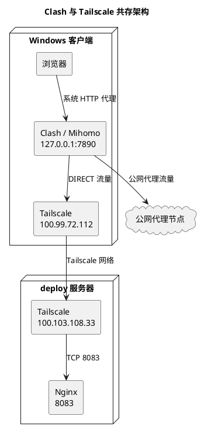
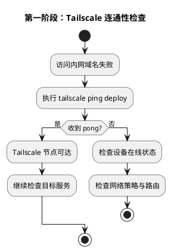
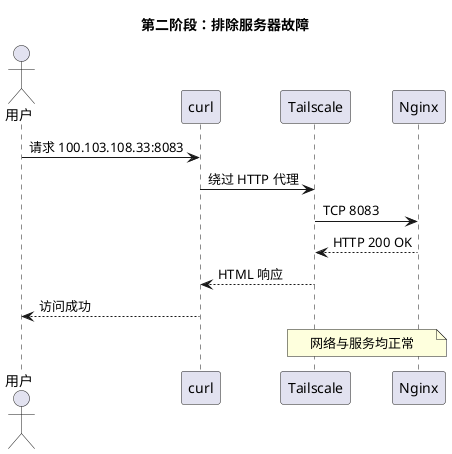
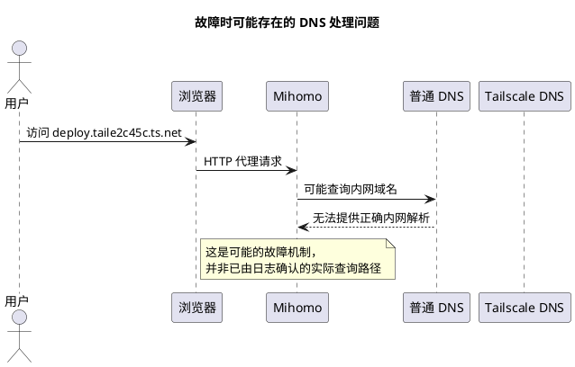
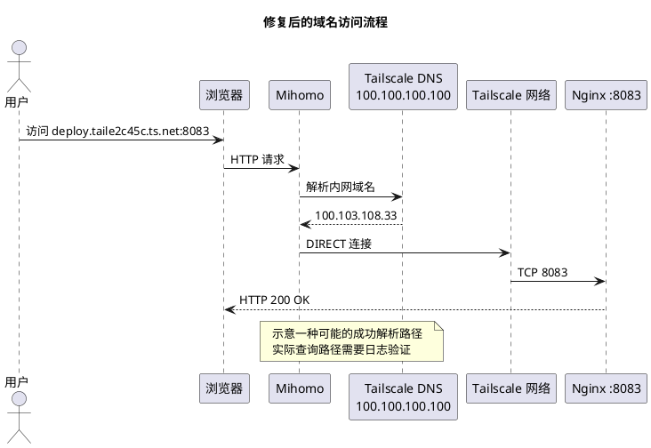
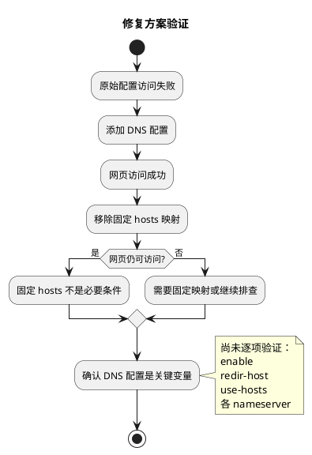
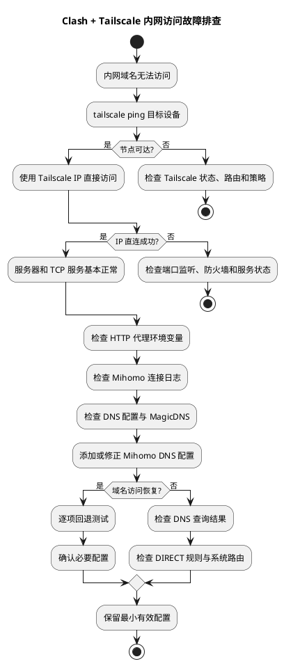
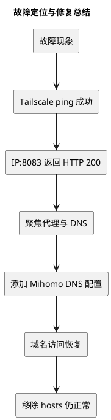

> 故障现象：Windows 同时运行 Clash/Mihomo 和 Tailscale 时，Tailscale 节点通信正常，内网服务可以通过 IP 访问，却无法通过 MagicDNS 域名访问。最终通过调整 Mihomo DNS 配置恢复正常。

## 一、故障背景

Windows 11 上同时运行了 Clash Verge Rev（Mihomo 内核）和 Tailscale。

Clash 使用系统代理模式，负责公网代理访问；Tailscale 则负责设备之间的虚拟专用网络连接。

访问下面的内网服务时出现了问题：

```text
http://deploy.taile2c45c.ts.net:8083/
```

环境信息如下：

| 组件 | 配置 |
| --- | --- |
| 操作系统 | Windows 11 |
| 代理客户端 | Clash Verge Rev / Mihomo |
| 代理模式 | Rule + 系统代理 |
| 本地代理端口 | 7890 |
| 组网工具 | Tailscale |
| 目标设备 | deploy |
| Tailscale IP | `100.103.108.33` |
| 服务端口 | 8083 |
| Web 服务 | Nginx |

最明显的现象是：关闭 Clash 后可以正常访问，开启 Clash 后却无法通过域名访问。

这让人首先怀疑代理或 DNS 处理存在问题。不过，仅凭开关 Clash 前后的表现，还不能确定具体原因，需要继续排查。

## 二、网络架构与故障位置



这里涉及两套不同的网络机制：

- **Clash/Mihomo**：根据规则决定请求走代理节点还是直连，同时也可能参与 DNS 解析。
- **Tailscale**：负责设备之间的虚拟网络连接，并通过 MagicDNS 提供设备名称解析。

两者负责的事情不同，但在域名访问过程中可能相互影响。

即使 Tailscale 隧道正常，Mihomo 仍可能因为域名解析或代理处理方式不合适，导致内网服务无法访问。

## 三、故障排查过程

### 1. 检查 Tailscale 连通性

先确认目标设备是否可以通过 Tailscale 访问：

```powershell
tailscale ping deploy
```

实际输出：

```text
pong from deploy (100.103.108.33)
via 94.249.172.46:41641 in 242ms
```

收到 `pong`，说明客户端可以通过 Tailscale 联系到目标设备。



**结论：Tailscale 节点可达。**

但 `tailscale ping` 成功只能说明节点之间可以通信，不能据此认定目标 Web 服务也正常。

### 2. 检查请求是否经过代理

接着使用 curl 请求内网服务：

```powershell
curl.exe -v http://deploy.taile2c45c.ts.net:8083/
```

观察到以下输出：

```text
Uses proxy env variable http_proxy == 'http://127.0.0.1:7890'
Trying 127.0.0.1:7890...
```

这说明 curl 使用了本地 Mihomo HTTP 代理。

不过，**请求进入 Mihomo，不等于请求一定会经过远程代理节点。**

Mihomo 仍然可以根据规则选择 `DIRECT`，直接连接目标地址。

因此，下一步需要绕过 HTTP 代理，检查 Tailscale IP 是否可以直接访问。

### 3. 绕过代理直接访问 Tailscale IP

执行：

```powershell
curl.exe --proxy "" --noproxy "*" -v --connect-timeout 10 http://100.103.108.33:8083/
```

实际返回：

```text
Trying 100.103.108.33:8083...
Established connection to 100.103.108.33
HTTP/1.1 200 OK
Server: nginx
Content-Type: text/html
```

这次请求成功，说明：

- Tailscale IP 路由正常。
- TCP 8083 端口可以连接。
- Nginx 正常响应请求。
- Web 服务能够返回页面。



到这里，已经可以基本排除目标服务器、Tailscale IP 连通性和 Web 服务本身的问题。

接下来重点检查客户端的域名解析和代理处理。

## 四、关键问题：Mihomo 与 MagicDNS

### 1. Tailscale MagicDNS 的工作方式

Tailscale 会为设备分配虚拟 IP。启用 MagicDNS 后，可以通过设备名称访问对应的 Tailscale IP。

例如：

```text
deploy.taile2c45c.ts.net
          ↓
    100.103.108.33
```

Tailscale 提供的 DNS 服务地址是：

```text
100.100.100.100
```

在正确配置的 Tailscale 环境中，可以通过这个地址解析相应的 MagicDNS 名称。

### 2. 为什么 Clash 会影响访问？

使用系统代理时，浏览器可能将完整的 HTTP 请求交给 Mihomo 处理。

在这种情况下，域名解析可能由 Mihomo 完成，而不一定直接使用 Windows 系统 DNS。

如果 Mihomo 的 DNS 配置没有正确处理 Tailscale 域名，就可能出现域名访问失败的情况。



这里需要说明：**本次排查没有抓取 DNS 查询日志，因此不能确定原配置是否真的将 MagicDNS 查询发送到了公共 DNS。**

上图只是可能的故障机制，并不是已经确认的实际请求路径。

不过，后续修改配置后的对照测试表明，Mihomo DNS 配置确实是影响访问结果的关键变量。

## 五、最终修复方案

最终通过添加以下 DNS 配置恢复了访问：

```yaml
dns:
  enable: true
  enhanced-mode: redir-host
  use-hosts: true
  nameserver:
    - 100.100.100.100
    - 1.1.1.1
```

各配置项的作用如下：

| 参数 | 说明 |
| --- | --- |
| `enable: true` | 启用 Mihomo DNS 功能 |
| `enhanced-mode: redir-host` | 使用真实 IP 解析模式 |
| `use-hosts: true` | 允许使用 hosts 映射 |
| `100.100.100.100` | Tailscale DNS 地址 |
| `1.1.1.1` | Cloudflare 公共 DNS |

配置生效后，原先无法打开的内网域名恢复了正常访问。

### 修复后的可能访问流程



上图展示的是一种可能的成功访问路径，实际 DNS 查询过程仍需要通过日志确认。

另外，`nameserver` 中同时配置了两个 DNS 地址，**并不代表 Mihomo 一定会先查询 Tailscale DNS，失败后再查询 Cloudflare DNS。**

具体查询行为还取决于 Mihomo 的解析策略和其他配置，不能仅凭 `nameserver` 中的排列顺序判断。

## 六、排除错误假设

排查过程中，还尝试过通过固定 hosts 映射解决问题：

```yaml
hosts:
  'deploy.taile2c45c.ts.net': 100.103.108.33
```

最初添加这条映射后，访问确实恢复了正常。

但继续测试时发现，移除固定 hosts 映射，网页仍然可以访问。

随后确认，仅添加前面的 DNS 配置，也能恢复访问。

因此，**至少在本次故障中，固定 hosts 映射不是必要条件。**



### 哪些结论已经验证？

| 判断 | 结果 |
| --- | --- |
| Tailscale 隧道故障 | 已排除 |
| Nginx 服务故障 | 已排除 |
| TCP 8083 不可达 | 已排除 |
| 必须固定 hosts | 已排除 |
| 添加 DNS 配置可以修复 | 已验证 |
| 一定是 `100.100.100.100` 单独起作用 | 尚未单独验证 |
| 原因一定是公共 DNS 解析错误 | 尚未通过日志验证 |

需要注意的是，虽然整组 DNS 配置已经验证有效，但还没有逐项回退测试。

因此，目前只能确认这组配置可以解决问题，不能断定其中某一个参数单独起了决定性作用。

## 七、通用故障排查流程

以后如果遇到类似问题，可以按照下面的顺序排查。



这套流程的重点是先确认网络和服务是否正常，再检查代理与 DNS。

如果 Tailscale 节点可达，而且通过 IP 能直接访问服务，就没有必要一开始便修改服务器配置。

此时更值得检查的是 HTTP 代理是否介入请求，以及域名究竟由谁解析。

## 八、进一步优化

目前使用的 DNS 配置已经验证有效，可以继续保留。

如果以后遇到其他 `ts.net` 域名解析异常，可以考虑使用 Mihomo 的 `nameserver-policy`，将 Tailscale 域名交给 Tailscale DNS 解析，普通公网域名则使用公共 DNS。

例如：

```yaml
dns:
  enable: true
  enhanced-mode: redir-host
  nameserver:
    - 1.1.1.1
  nameserver-policy:
    '+.ts.net':
      - 100.100.100.100
```

这是一种可选的配置方式，**并不是本次已经测试通过的修复方案。**

实际使用前，还需要确认当前 Mihomo 版本支持对应语法，并测试域名解析结果，避免引入新的问题。

## 九、总结

这次故障的定位与修复过程如下：



最终确认，本次故障与 Clash/Mihomo 和 Tailscale MagicDNS 的协同配置有关。

Tailscale 节点可以正常通信，目标 Web 服务也能通过 IP 访问。添加 Mihomo DNS 配置后，域名访问恢复正常，而且不需要保留固定 hosts 映射。

不过，由于没有抓取 DNS 查询日志，也没有逐项测试 DNS 参数，目前还不能确定具体是哪一个参数起了决定性作用。

这次排查也说明，**网络可达、服务可用、DNS 解析正常和代理转发正确，是四个需要分别验证的问题。**

遇到内网域名无法访问时，不必急着修改服务器配置或不断添加代理规则。先确认节点是否可达、服务是否能通过 IP 访问，再检查代理和 DNS，通常更容易缩小问题范围。

对于同时运行 Clash/Mihomo 和 Tailscale 的环境，如果 IP 可以访问而 MagicDNS 域名无法访问，优先检查 Mihomo 的 DNS 配置及其与 MagicDNS 的协同方式，比单纯增加 `DIRECT` 规则更有针对性。
