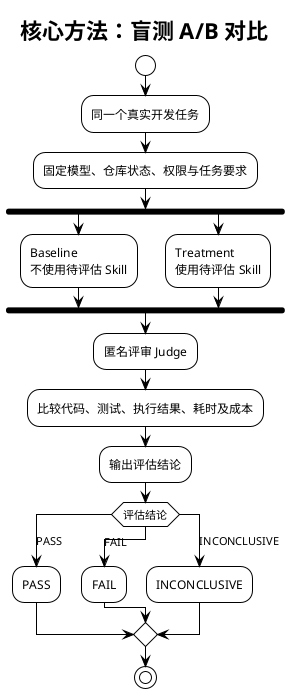

## Skill Eval：你编写的 Skill 评估工具

Skill Eval 是你在 [codex-development-workflow PR #220](https://github.com/i-zrhe2016/codex-development-workflow/pull/220) 中新增的一个 Codex Skill，主要用于评估其他 Skill 是否真正有效。

它的核心思想是：

不只是检查 AI 有没有遵循 Skill，而是验证使用 Skill 后，实际任务完成得是否更好。

### 一、四个评估维度

| 维度 | 评估内容 |
| --- | --- |
| Static（静态） | Skill 编写是否规范，职责、触发条件是否明确 |
| Trigger（触发） | 该使用 Skill 时是否触发，不该使用时是否误触发 |
| Behavior（行为） | AI 是否真正执行 Skill 要求的步骤 |
| Outcome（结果） | Skill 是否改善实际任务结果 |

其中，Outcome 是最终判断 Skill 有效性的决定性依据。

### 二、核心方法：盲测 A/B 对比



### 三、结合你的开发工作流，可以评估什么？

例如，你可以使用 `skill-eval` 评估自己编写的其他 Skill：

| Skill | 可以评估的问题 |
| --- | --- |
| `plan-workflow` | 是否让开发计划更合理、遗漏更少 |
| `develop-workflow` | 是否提高代码质量、减少返工 |
| `verify-workflow` | 是否发现更多真实缺陷 |
| `test-workflow` | 是否提升测试有效性 |
| `plan-to-ticket` | 是否改善复杂任务的拆分和依赖管理 |
| `integrate-workflow` | 是否降低合并冲突与集成错误 |

例如，评估 `develop-workflow` 时，让 Codex 分别在使用和不使用该 Skill 的情况下完成相同开发任务，再比较最终代码是否通过测试、存在多少缺陷、耗费多少 Token 和时间。

### 四、如何使用

在 Codex 中可以这样要求：

```text
使用 $skill-eval 评估 develop-workflow。

通过真实开发任务进行盲测 A/B 对比，
检查 Static、Trigger、Behavior、Outcome，
比较任务质量、Token 成本和完成时间，
最后输出 PASS、FAIL 或 INCONCLUSIVE。

```

### 五、当前能力边界

你的 `skill-eval` 是评估方法规范（Playbook），不是自动化测试程序。

它已经定义了评估步骤、证据要求、盲测方法和结论格式，但没有实现自动启动多个 Codex 实例、自动采集数据或批量执行实验的 Runner。

因此，当前最适合用于指导 Codex 对某个 Skill 开展有证据的评估，而不是一键批量测试全部 Skill。

一句话总结：`skill-eval` 是你整个 Codex 开发工作流中的「Skill 质量评估器」，用于判断一个 Skill 是否真正提高开发质量或效率，而不只是看它写得是否规范。
